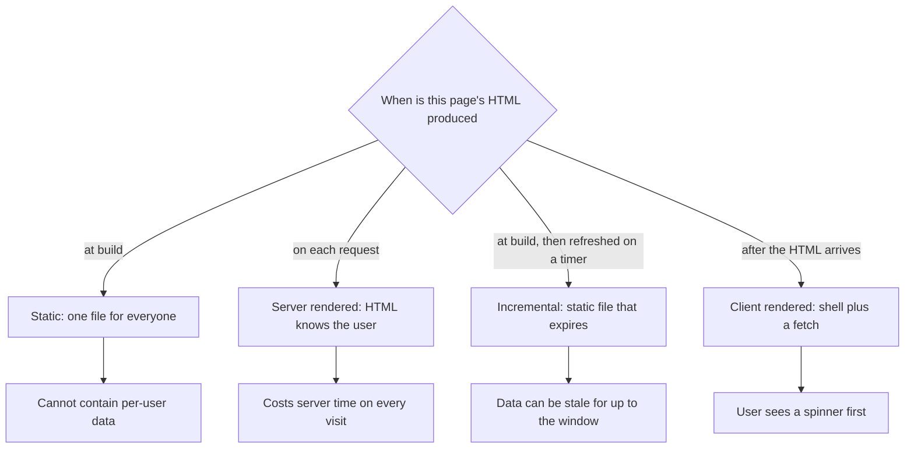
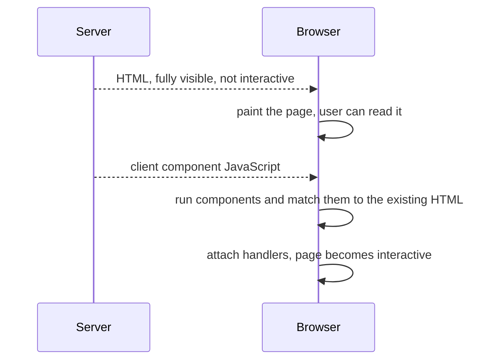

# Rendering Strategies — Part 1

File 02 answered "which machine runs this component?". This file answers the
follow-up question: **when** does that machine run it? Once, months ago, during
a build? Freshly, for this exact request? Only after the HTML already reached
the browser?

The answer changes almost everything that matters. It decides whether a page
can contain the logged-in user's name. It decides what happens when your
database is slow. It decides whether a deploy is needed to fix a typo in your
pricing page. And it produces one of the most embarrassing bugs in web
development, which Part 1 shows you how to avoid.

> **📌 In one line:** every page's HTML is produced at some moment — build
> time, request time, or in the browser — and a page built before the request
> cannot possibly know who is asking.

Everything here describes the App Router. Exact option names and defaults move
between versions, so treat names as pointers and check your version's docs.

Part 2 covers streaming, the caching layers, revalidation, SEO and the cost of
rendering on every request.

## Table of Contents

1. [Four Moments When HTML Can Be Made](#four-moments-when-html-can-be-made)
2. [The Four Strategies, Drawn](#the-four-strategies-drawn)
3. [A Decision Table](#a-decision-table)
4. [Walking Real SaaS Pages Through It](#walking-real-saas-pages-through-it)
5. [The Bug: a Name Cached Into a Shared Page](#the-bug-a-name-cached-into-a-shared-page)
6. [Hydration, Simply](#hydration-simply)
7. [Hydration Mismatches and Their Fixes](#hydration-mismatches-and-their-fixes)
8. [Common Mistakes](#common-mistakes)
9. [Questions to Test Yourself](#questions-to-test-yourself)
10. [Related](#related)

---

## Four Moments When HTML Can Be Made

**Static, at build time.** When you run the build, Next.js renders the page
once and writes the HTML to a file. Every visitor gets that same file. It is
served like an image: no computation, no database, instantly, from anywhere.

Real-life comparison: a printed poster. Fast to hand out, identical for
everyone, and changing it means printing again.

**Server-rendered, per request.** The page is rendered when someone asks for
it. The HTML can contain anything that request knows — the logged-in user, the
current time, their company's data.

Real-life comparison: a receipt printed at the till. Made for one person, at
one moment, with their actual items on it.

**Incrementally regenerated.** The page is static, but it quietly expires. The
first request after the expiry triggers a fresh render in the background, and
the new version replaces the old one. Visitors keep getting a file, not a
computation.

Real-life comparison: a daily menu board. Printed and reused all day, rewritten
when it goes stale.

**Client-rendered.** The server sends a mostly empty shell. JavaScript loads,
runs, calls your API, and fills the page in the browser.

Real-life comparison: a blank form that fills itself after you walk in. Nothing
useful is in the first response.

> **💡 Tip:** these are not four frameworks. They are four answers to one
> question — *when* — and in the App Router you often choose per route, not per
> application.

---

## The Four Strategies, Drawn



The same four as a table of consequences:

| Strategy | HTML produced | Can contain per-user data | Cost per visit | Typical failure |
|---|---|---|---|---|
| Static | at build | no | almost none | stale until next deploy |
| Server-rendered | per request | yes | a render plus your queries | slow page when the database is slow |
| Incremental | at build, refreshed on a timer | no | almost none | stale within the window |
| Client-rendered | in the browser | yes | a round trip after load | spinner, then a layout shift |

In the App Router you do not usually pick these with a switch. A page is
treated as static when nothing in it depends on the request, and as
server-rendered as soon as something does — reading cookies, reading headers,
reading `searchParams`, or opting out of caching explicitly. Option names for
forcing one or the other differ between versions; check your version's docs.

> **⚠️ Warning:** that automatic behaviour is why a page can silently change
> strategy. Someone adds a cookie read to a shared helper, and a static page
> becomes a per-request render across your whole app. The build output tells
> you; nothing else will.

---

## A Decision Table

| Content type | Strategy | Why |
|---|---|---|
| Marketing and pricing pages | Static | Same for everyone, must be fast, rarely changes |
| Public docs and changelog | Static or incremental | Same for everyone, changes without a deploy |
| Logged-in dashboard | Server-rendered | Content is specific to one user and must be current |
| Public invoice link shared with a client | Server-rendered | Public, but each link shows different data |
| Settings page | Server-rendered | Per-user, and a stale value here is a real bug |
| Status page with aggregate numbers | Incremental | Same for everyone, cheap to be a minute old |
| An interactive chart with filters | Server shell, client-rendered data | The user drives the queries after load |
| An admin report over a huge table | Server-rendered with streaming | Slow, per-user, and should not block the shell |

Two rules compress most of this.

**If the content depends on who is asking, it cannot be static.** No exceptions,
no clever caching.

**If the content is the same for everyone, do not render it per request.** You
are paying for a computation whose answer you already had.

---

## Walking Real SaaS Pages Through It

**The marketing page at `/pricing`.** Identical for every visitor. No cookies,
no session. Static. It becomes a file on a CDN, loads in milliseconds anywhere
in the world, and costs nothing per visit. A price change needs a deploy, or an
incremental window if your content lives in a CMS.

**The logged-in dashboard at `/companies/14`.** Shows this user's company, this
user's open tasks, this user's unpaid invoices. It reads the session cookie, so
it cannot be static — and should not be, because showing a colleague's numbers
would be a security incident. Server-rendered, every time.

**The public invoice link at `/invoices/share/abc123`.** Interesting, because it
is public — no login — but still different per URL. Server-rendered. The token
in the URL is the only authorization, so it must be long, random and
revocable, and the page must never be cached in a way that lets one token's
page be served for another.

**The settings page at `/settings`.** Per-user, and the stakes are higher than
they look. If a user turns off email notifications and the page shows the old
value on reload, they will assume it did not save and turn it off again.
Server-rendered, and after a write, revalidated — Part 2 covers how.

---

## The Bug: a Name Cached Into a Shared Page

Here is the failure that gives this whole topic its weight.

A page is static. Someone adds a greeting with the user's name. The build
renders that page once, with whichever user happened to be resolvable at build
time — or with the first visitor's data, if a cache in front of the app stores
the response. Every subsequent visitor receives that same HTML.

The result is one user's name, and sometimes one user's data, shown to
everybody.

```tsx
// ❌ BROKEN - per-user content on a page that is cached and shared
// app/dashboard/page.tsx

export const revalidate = 3600   // "cache this page for an hour"

export default async function Dashboard() {
  const user = await getCurrentUser()        // who is "current" at build time?
  const tasks = await listMyTasks()

  return (
    <>
      <h1>Welcome back, {user.firstName}</h1>
      <TaskList tasks={tasks} />
    </>
  )
}
```

The mistake is not the greeting. It is the combination: a cache key that is the
URL, and content that depends on something the URL does not contain.

```tsx
// ✅ FIXED - reading the session makes this per-request, and the cache is off
// app/dashboard/page.tsx
import { cookies } from 'next/headers'
import { redirect } from 'next/navigation'

export const dynamic = 'force-dynamic'   // never serve this from a shared cache

export default async function Dashboard() {
  const session = (await cookies()).get('session_token')?.value
  if (!session) redirect('/login')

  const user = await getCurrentUser(session)
  const tasks = await listMyTasks(session)

  return (
    <>
      <h1>Welcome back, {user.firstName}</h1>
      <TaskList tasks={tasks} />
    </>
  )
}
```

> **⚠️ Warning:** this is the same class of bug as caching a per-user API
> response under a key that has no user in it.
> [When to Cache](../../caching-and-background-jobs/01-caching-in-practice/01-when-to-cache.md)
> states the rule plainly: the cache key must contain everything the value
> depends on. A static page's key is just its URL.

The safe habit: **per-user pages read the session explicitly and say so.** When
the session read is visible in the page file, both the framework and the next
reader can see that this page belongs to one person.

---

## Hydration, Simply

Static and server-rendered pages both send real HTML. But HTML has no
behaviour. A button in that HTML does nothing when clicked, because nothing has
attached a handler to it yet.

**Hydration** is the step that fixes this. The browser displays the HTML
immediately, then downloads the client components' JavaScript, runs them, and
attaches their behaviour to the elements already on screen.



Two consequences follow.

**There is a window where the page looks ready but is not.** A user who clicks
in the first moments may see nothing happen. This is normal; keeping the client
bundle small is what shortens it.

**React must agree with itself.** For hydration to work, what the client
renders must match what the server already rendered. If they differ, React
cannot trust the existing HTML.

---

## Hydration Mismatches and Their Fixes

A hydration mismatch means the server produced one thing and the browser
produced another for the same component. You will see a console error about
server-rendered HTML not matching, and sometimes visibly wrong output.

Every cause is a value that is different on the two machines.

| Cause | Why it differs | Fix |
|---|---|---|
| `Date.now()` or `new Date()` in render | The two machines render at different moments | Render in `useEffect`, or pass a fixed timestamp as a prop |
| `window`, `localStorage`, `navigator` | They do not exist on the server | Read inside `useEffect`, render a neutral value first |
| `toLocaleDateString()` with no fixed locale | Server locale differs from the user's | Pass an explicit locale and time zone |
| `Math.random()` or a generated id | Two independent random values | Generate on the server and pass down, or use React's id hook |
| Browser extensions altering the DOM | Not your code at all | Usually ignorable; verify in a clean profile |
| Different data on the two renders | The client refetched and got newer rows | Pass the server's data down rather than refetching |

```tsx
// ❌ BROKEN - "2 hours ago" is computed twice, two seconds apart
'use client'
export function RelativeTime({ iso }: { iso: string }) {
  return <time>{formatRelative(new Date(iso), new Date())}</time>
}
```

```tsx
// ✅ FIXED - render the stable value first, upgrade after mount
'use client'
import { useState, useEffect } from 'react'

export function RelativeTime({ iso }: { iso: string }) {
  const [relative, setRelative] = useState<string | null>(null)
  useEffect(() => { setRelative(formatRelative(new Date(iso), new Date())) }, [iso])

  // Server and first client render both produce the absolute date: they match.
  return <time dateTime={iso}>{relative ?? new Date(iso).toISOString().slice(0, 10)}</time>
}
```

> **📌 Remember:** the fix is always the same shape. Render something both
> machines can agree on, then change it after mount, because `useEffect` only
> ever runs in the browser.

---

## Common Mistakes

| Mistake | Why it is wrong | Do this instead |
|---|---|---|
| Per-user content on a cached page | The cache key is the URL, which has no user in it | Read the session and render per request |
| Assuming a page is static because it is simple | A cookie read anywhere in it changes the strategy | Read the build output after changes |
| Server-rendering a page identical for everyone | Paying per visit for one unchanging answer | Make it static or incremental |
| `new Date()` inside a rendered component | The two machines render at different moments | Compute after mount, or pass a fixed value |
| `toLocaleDateString()` with no locale argument | Server and browser locales differ | Pass locale and time zone explicitly |
| Fixing a mismatch by disabling server rendering | Hides the cause and loses the fast first paint | Find the value that differs |
| Treating a share token as if it were a login | The URL is the only secret | Long, random, revocable, never cached across tokens |
| Ignoring the hydration warning in the console | It means the DOM React sees is not the DOM it expected | Fix it; mismatches cause real visual bugs |

---

## Questions to Test Yourself

1. Name the four moments at which a page's HTML can be produced, and give one
   real SaaS page for each.
2. Why can a statically generated page never contain the logged-in user's name?
   Answer in terms of cache keys, not in terms of Next.js.
3. A static page starts rendering per request after an unrelated change. Name
   two edits that could cause that, and where you would notice.
4. Explain hydration to someone who has only written backend code, in three
   sentences.
5. What exactly is a hydration mismatch, and why does React complain rather
   than silently fixing the difference?
6. `Date.now()` in a component causes a mismatch. What is the general shape of
   the fix, and why does `useEffect` make it work?
7. A public invoice-share link is server-rendered. Give two caching rules it
   must follow and one property its token must have.
8. Your settings page shows a stale value after a save. Which strategy is it
   probably using, and what is the user's likely next action?

---

> **➡️ Continued in [Part 2](./03-rendering-strategies-part-2.md)** — streaming
> and Suspense, the caching layers, revalidation, SEO and the cost of rendering
> on every request.

## Related

- [Rendering Strategies — Part 2](03-rendering-strategies-part-2.md) —
  streaming, caching layers and revalidation.
- [Server and Client Components — Part 1](02-server-and-client-components-part-1.md)
  — which machine runs the code whose timing this file decides.
- [caching-and-background-jobs/01-caching-in-practice/01-when-to-cache.md](../../caching-and-background-jobs/01-caching-in-practice/01-when-to-cache.md)
  — the cache-key rule that the shared-page bug breaks.
- [React Fundamentals — Hooks That Matter Part 1](../01-react-fundamentals/03-hooks-that-matter-part-1.md)
  — why `useEffect` is the reliable place for browser-only values.
