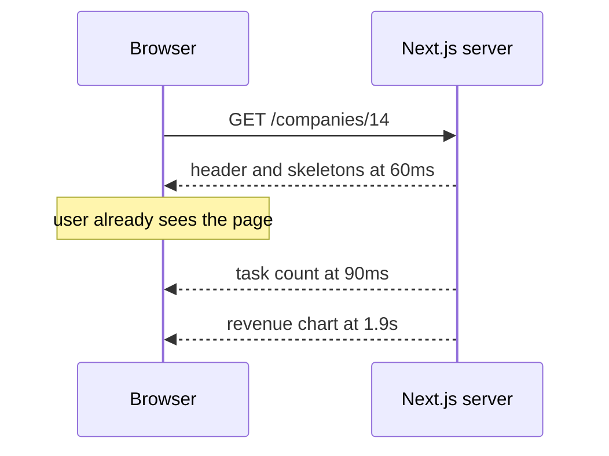
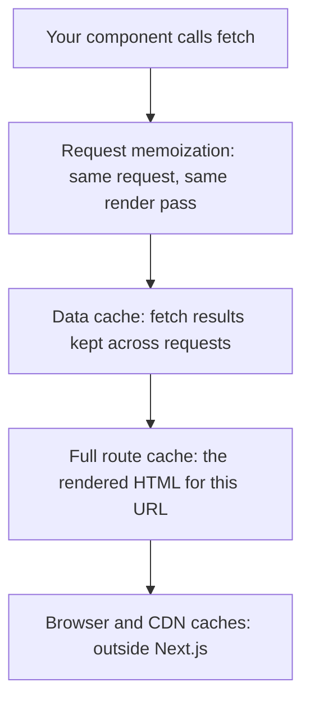

# Rendering Strategies — Part 2

Part 1 asked *when* a page's HTML is produced. This part deals with what
happens around that moment: how to send a page before all of its data is ready,
why a page you just changed still shows the old content, and how to make it
update without a deploy.

The caching sections are the ones that cost people days. Next.js caches things
you did not ask it to cache, in several layers, with defaults that change
between versions. The goal here is not to memorise flag names — they will move.
The goal is a mental model solid enough that when a page refuses to update, you
know which layer to suspect.

> **📌 In one line:** send the shell first and stream the slow parts in, and
> assume something is caching your data until you have said otherwise.

> **⬅️ This continues [Part 1](./03-rendering-strategies-part-1.md).**

## Table of Contents

1. [Streaming: Send the Shell First](#streaming-send-the-shell-first)
2. [Why Streaming Beats Blocking](#why-streaming-beats-blocking)
3. [The Caching Layers](#the-caching-layers)
4. [Something Is Caching Your Fetch](#something-is-caching-your-fetch)
5. [Revalidation: Time-Based and On-Demand](#revalidation-time-based-and-on-demand)
6. [Where Revalidation Belongs Around a Write](#where-revalidation-belongs-around-a-write)
7. [Advanced: SEO, Briefly](#advanced-seo-briefly)
8. [Advanced: The Cost of Rendering Every Request](#advanced-the-cost-of-rendering-every-request)
9. [Common Mistakes](#common-mistakes)
10. [Questions to Test Yourself](#questions-to-test-yourself)
11. [Related](#related)

---

## Streaming: Send the Shell First

A dashboard needs four things: the company header, the open task count, the
unpaid invoice total, and a twelve-month revenue chart. Three of those queries
take 30 milliseconds. The chart takes 1.8 seconds.

Rendered as one block, the user waits 1.8 seconds and sees nothing at all. The
fast parts are held hostage by the slow one.

Streaming breaks that. The server sends the page in pieces as they become
ready. Anything wrapped in a `<Suspense>` boundary is allowed to arrive late;
everything else goes out immediately with a placeholder in its place.

```tsx
// app/companies/[id]/page.tsx - server component
import { Suspense } from 'react'

export default async function CompanyPage({ params }: PageProps) {
  const { id } = await params
  const company = await getCompany(id)   // fast, the page waits for this

  return (
    <>
      <CompanyHeader company={company} />

      <Suspense fallback={<StatSkeleton />}>
        <OpenTaskCount companyId={id} />
      </Suspense>

      <Suspense fallback={<ChartSkeleton height={240} />}>
        {/* this component awaits 1.8s of work and does not block the rest */}
        <RevenueChart companyId={id} />
      </Suspense>
    </>
  )
}
```



The whole response still finishes at 1.9 seconds. What changed is that useful
content appeared at 60 milliseconds instead of 1.8 seconds.

> **💡 Tip:** put a Suspense boundary exactly where the slow data is, not
> around the whole page. A boundary around everything gives you back the
> all-or-nothing behaviour you were trying to escape.

---

## Why Streaming Beats Blocking

You already have the right instinct for this from the server side. When you
look at endpoint latency, you do not look at the average. You look at the
percentiles, because the average hides the slow tail and the slow tail is what
users actually experience. That is the argument in
[Metrics and Health Checks](../../backend-fundamentals/08-logging-and-observability/04-metrics-and-health-checks-part-1.md).

A blocking page makes every part of the page share the slowest part's
percentile. Your header has p99 latency of 1.9 seconds, not because rendering a
header is slow, but because it was in the same response as a chart.

| Approach | Time to first useful content | Time to complete | What the user sees |
|---|---|---|---|
| Block on everything | 1.9s | 1.9s | a white page, then everything |
| Stream with Suspense | 60ms | 1.9s | header now, chart fills in |
| Client-fetch the chart | 60ms plus bundle | 2.1s | header now, chart after more round trips |

Streaming also fails better. If the chart query throws, an `error.tsx` or error
boundary inside that Suspense region can show a small "could not load revenue"
box while the rest of the page stays useful. A blocking page turns one failed
query into a failed page.

> **📌 Remember:** streaming does not make anything faster. It changes who
> waits for what. That is usually a bigger win than shaving milliseconds.

---

## The Caching Layers

This is where people lose days. Next.js has several caches, they sit at
different levels, and their defaults have changed across versions. Learn the
layers, not the flags.



| Layer | What it stores | Lives for | Typical surprise |
|---|---|---|---|
| Request memoization | the result of identical `fetch` calls | one render pass | none, this one is helpful |
| Data cache | `fetch` responses | across requests and deploys, until revalidated | your API returned new data and the page did not change |
| Full route cache | the rendered HTML of a route | until revalidated or redeployed | the whole page is frozen |
| Client router cache | visited route payloads in the browser | a short window | going back shows old content |

**Request memoization** solves a real problem. Three components on one page
each need the current user. Each calls `getCurrentUser()`. Within a single
render pass, identical `fetch` calls are made once and shared. You can fetch
where the data is needed rather than threading it through props.

**The data cache** is the one that surprises people. A `fetch` in a server
component may be stored and reused for later requests, which is wonderful for a
list of countries and wrong for an invoice total.

**The full route cache** stores the rendered output of a whole route. This is
the mechanism behind static pages from Part 1.

> **⚠️ Warning:** defaults here have genuinely changed between Next.js
> versions — in some versions `fetch` was cached unless you opted out, in
> others the reverse. Do not rely on memory or on a blog post. Check your
> version's documentation, and be explicit in your own code so the behaviour
> does not depend on an upgrade.

---

## Something Is Caching Your Fetch

The practical rule, version-independent: **state your intent on every fetch of
data that can change.** Explicit code survives an upgrade; a default does not.

```ts
// ❌ BROKEN - relies on whatever the current default happens to be
export async function getInvoiceTotal(companyId: string): Promise<number> {
  const res = await fetch(`${API}/companies/${companyId}/invoices/total`)
  const body = (await res.json()) as { total: number }
  return body.total
  // Works today. After an upgrade, or after a deploy, may serve last week's
  // total from the data cache and never call your API at all.
}
```

```ts
// ✅ FIXED - intent is in the code, not in a framework default
export async function getInvoiceTotal(companyId: string): Promise<number> {
  const res = await fetch(`${API}/companies/${companyId}/invoices/total`, {
    cache: 'no-store',            // money changes; never reuse a stored copy
  })
  if (!res.ok) throw new Error(`invoice total failed: ${res.status}`)
  const body = (await res.json()) as { total: number }
  return body.total
}

export async function listCountries(): Promise<Country[]> {
  const res = await fetch(`${API}/reference/countries`, {
    next: { revalidate: 86400 }, // changes about once a year; a day is generous
  })
  if (!res.ok) throw new Error(`countries failed: ${res.status}`)
  return (await res.json()) as Country[]
}
```

When a page will not update, work down the layers in order:

1. Is your API actually returning new data? Call it directly with `curl`.
2. Is the fetch cached? Set `cache: 'no-store'` temporarily and retest.
3. Is the route cached? Check whether the page is static in the build output.
4. Is something in front of Next.js caching it — a CDN, a proxy, the browser?

```text
$ curl -s https://api.internal/companies/14/invoices/total
{"total":48250}

# API is fresh, page shows 41000 -> the problem is layer 2 or 3, not your API
```

> **💡 Tip:** this debugging order is the same one you use for a Redis cache
> bug: confirm the source of truth first, then walk outward through each layer
> that could be holding a copy.

---

## Revalidation: Time-Based and On-Demand

Revalidation is how cached content gets replaced. Two kinds.

**Time-based.** You declare a maximum staleness window. After it passes, the
next request triggers a refresh in the background while still serving the old
copy; the one after that gets the new one.

```ts
// on a single fetch
await fetch(url, { next: { revalidate: 60 } })
```

```ts
// for a whole route, as a page-level export
export const revalidate = 300   // this route may be up to five minutes stale
```

**On-demand.** You tell Next.js that a specific thing has changed, right now,
usually straight after a write.

```ts
import { revalidatePath, revalidateTag } from 'next/cache'

revalidatePath(`/companies/${companyId}/invoices`)  // this URL is now stale
revalidateTag(`company-${companyId}-invoices`)      // everything with this tag
```

Tags are the more useful of the two once an app grows. You attach a tag when
fetching, then invalidate by tag after a write, and you do not have to remember
every URL that displayed the data.

```ts
await fetch(`${API}/companies/${companyId}/invoices`, {
  next: { tags: [`company-${companyId}-invoices`] },
})
```

| Question | Time-based | On-demand |
|---|---|---|
| Who decides it is stale | the clock | your code, after a write |
| Freshness | up to the window | immediate |
| Cost | one refresh per window | one refresh per change |
| Good for | reference data, public pages | anything a user just edited |
| Risk | a user sees their own edit undone | forgetting a place that shows the data |

---

## Where Revalidation Belongs Around a Write

The ordering question matters, and you have solved it before.

The write happens in your AdonisJS API. The cache that must be invalidated is
in Next.js. So the sequence is: call the API, wait for a successful response,
*then* revalidate. Revalidating first means you may refresh the cache with the
old value, moments before it changes.

```ts
// ✅ the only safe order
const updated = await apiClient.patch(`/invoices/${id}`, { status: 'paid' })
revalidateTag(`company-${updated.companyId}-invoices`)
```

This is exactly the invalidation ordering problem from
[Invalidation in Practice](../../caching-and-background-jobs/01-caching-in-practice/03-invalidation-in-practice-part-1.md):
write to the source of truth first, invalidate after, and accept that there is
a small window where a reader may still see the old value. The Next.js data
cache is one more copy of your data, and copies have the same rules wherever
they live.

> **⚠️ Warning:** if the same data is edited by a mobile app or an admin tool
> that never touches Next.js, no `revalidateTag` call will ever run for those
> edits. Time-based revalidation is your safety net for changes your frontend
> did not make.

---

## Advanced: SEO, Briefly

SEO is low priority for an internal SaaS product, and this track treats it that
way. One thing about it is genuinely relevant here, and it is a consequence of
rendering strategy rather than a separate topic.

A crawler asks for a URL and reads the response. If your content only appears
after JavaScript has run and called your API, a crawler may see an empty page.
Static and server-rendered pages send real content in the first response, so
there is nothing to miss.

That gives a short rule: **pages you want found by search engines must not be
client-rendered.** Your marketing site, pricing page, public docs and
changelog. Your dashboard is behind a login and no crawler will ever see it.

The other mechanical piece is page metadata — title and description per route,
exported from a `page` or `layout` file. Set it for public pages so a shared
link shows something sensible. Everything else in SEO is a content and linking
discipline, not a framework feature, and it is outside this track.

---

## Advanced: The Cost of Rendering Every Request

Server rendering is not free, and the bill arrives in three forms.

**Compute.** Every visit runs your component functions. A page viewed a million
times a day runs them a million times. Static pages run them once.

**Latency.** The user waits for your render plus every query inside it. Each
sequential `await` adds to the wait — which is why file 04 spends a section on
waterfalls.

**Load on everything behind you.** A server-rendered dashboard calls your
AdonisJS API on every page view, which queries PostgreSQL on every page view.
Your frontend's traffic is now your database's traffic.

| Pressure | Reduce it by |
|---|---|
| Compute per visit | make genuinely shared pages static or incremental |
| Page latency | fetch in parallel, stream the slow parts |
| Backend load | cache reference data with a sensible window |
| Database connections | keep the frontend behind your API, which owns the pool |
| Slow tail | measure p95 and p99, not the average |

> **📌 Remember:** a server-rendered page is an endpoint. Everything you
> already know about endpoint cost, caching and load applies to it, because it
> is the same thing with HTML in the response body.

---

## Common Mistakes

| Mistake | Why it is wrong | Do this instead |
|---|---|---|
| One Suspense boundary around the whole page | You are back to all-or-nothing | Wrap only the slow component |
| Relying on the framework's caching default | Defaults differ between versions | State `cache` or `revalidate` explicitly |
| Blaming your API when a page will not update | A copy between you and it is stale | Walk the layers from the API outward |
| `revalidateTag` before the write completes | You may cache the old value | Await the write, then revalidate |
| Only on-demand revalidation | Edits from other clients never trigger it | Add a time-based window as a safety net |
| Caching a per-user response by URL | The key has no user in it | Do not cache it, or include the user in the key |
| Client-rendering a public marketing page | A crawler may see an empty shell | Static or server-rendered |
| Server rendering a page identical for everyone | Compute and database load per visit, for one answer | Static or incremental |

---

## Questions to Test Yourself

1. A page has one query at 30ms and one at 1.8s. Describe what the user sees
   with and without streaming, and state what streaming did *not* improve.
2. Why does a blocking page give your fast header the same p99 as its slowest
   query? Relate it to percentile thinking on the server.
3. Name the three caching layers inside Next.js and what each one stores.
4. Your API clearly returns the new invoice total and the page shows the old
   one. List the checks you would make, in order.
5. Why is explicit `cache` or `revalidate` on every fetch better than relying
   on the default, even when the default is currently what you want?
6. Compare time-based and on-demand revalidation. Give one case where you need
   both on the same data.
7. Why must `revalidateTag` run after the API write and not before?
8. Which pages in a SaaS product genuinely need SEO, and what does that forbid
   about how they are rendered?

---

## Related

- [Rendering Strategies — Part 1](03-rendering-strategies-part-1.md) — the four
  strategies, the decision table and hydration.
- [caching-and-background-jobs/01-caching-in-practice/03-invalidation-in-practice-part-1.md](../../caching-and-background-jobs/01-caching-in-practice/03-invalidation-in-practice-part-1.md)
  — the ordering rule that the revalidation section applies.
- [backend-fundamentals/08-logging-and-observability/04-metrics-and-health-checks-part-1.md](../../backend-fundamentals/08-logging-and-observability/04-metrics-and-health-checks-part-1.md)
  — the percentile thinking behind the streaming argument.
- [04-data-fetching-and-mutations-part-1.md](04-data-fetching-and-mutations-part-1.md)
  — writing the fetches whose caching this file governs.
- [04-data-fetching-and-mutations-part-2.md](04-data-fetching-and-mutations-part-2.md)
  — the write that triggers revalidation.
