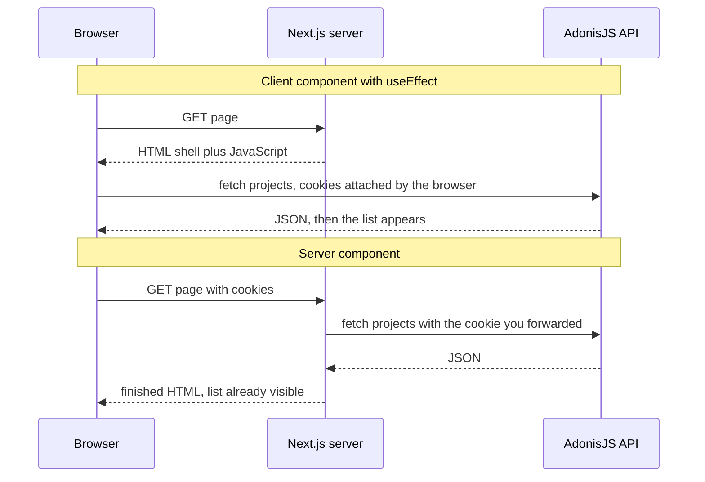
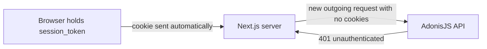

# Data Fetching and Mutations — Part 1

In [React Fundamentals](../01-react-fundamentals/05-talking-to-your-api-part-1.md)
you learned to fetch from a component the hard way: a `useEffect`, three pieces
of state, a race condition, an `AbortController`, and four outcomes to draw.
That work was not wasted — it is still exactly what happens in a client
component, and it is what a data-fetching library does for you.

But a server component changes the problem completely. It runs on a server,
once, and it can simply wait for data before returning anything. No effect, no
loading state, no race.

This part covers reading: `async` components, calling your own AdonisJS API
with the user's session attached, the waterfall mistake, and the route-level
files that handle loading and failure. Part 2 covers writing — server actions,
when to use your existing API instead, and revalidating afterwards.

> **📌 In one line:** a server component awaits its data directly, which
> removes three of the four request states — but it has no cookies unless you
> forward them, and two awaits in a row cost you two round trips.

## Table of Contents

1. [Fetching Without useEffect](#fetching-without-useeffect)
2. [Compared With the Client Version](#compared-with-the-client-version)
3. [Calling Your AdonisJS API From a Server Component](#calling-your-adonisjs-api-from-a-server-component)
4. [The Cookie Trap](#the-cookie-trap)
5. [Waterfalls: Sequential Versus Parallel](#waterfalls-sequential-versus-parallel)
6. [loading.tsx and Where to Put Suspense](#loadingtsx-and-where-to-put-suspense)
7. [error.tsx: What It Catches and What It Does Not](#errortsx-what-it-catches-and-what-it-does-not)
8. [Common Mistakes](#common-mistakes)
9. [Questions to Test Yourself](#questions-to-test-yourself)
10. [Related](#related)

---

## Fetching Without useEffect

A server component may be an `async` function. React waits for it, then renders
what it returns.

```tsx
// app/companies/[id]/projects/page.tsx - server component
import { listProjects } from '@/lib/api/projects'

export default async function ProjectsPage({ params }: PageProps) {
  const { id } = await params
  const projects = await listProjects(id)

  if (projects.length === 0) return <EmptyProjects companyId={id} />

  return (
    <ul>
      {projects.map((project) => (
        <li key={project.id}>{project.name}</li>
      ))}
    </ul>
  )
}
```

That is the whole component. Read what is missing: no `useState`, no
`useEffect`, no `isLoading`, no `error` variable, no cleanup function, no
`AbortController`.

The reason is structural, not a trick. The component is a function that runs on
a server and returns markup. It can wait. A browser component cannot wait —
it must return *something* immediately, and that something is why loading state
exists at all.

Notice that the empty case is still yours. Zero projects is a successful
response, not an error, and nothing in the framework will render an empty state
for you.

> **💡 Tip:** if you find yourself writing `useEffect` plus `fetch` in a Next.js
> app, stop and ask whether that component needs to be a client component at
> all. Usually the data can be fetched above it, on the server, and passed down.

---

## Compared With the Client Version

| Concern | Client component with `useEffect` | Server component |
|---|---|---|
| Loading state | you write it | `loading.tsx` or Suspense |
| Error state | you write it | `error.tsx` |
| Empty state | you write it | you still write it |
| Race condition on fast typing | real, needs `AbortController` | cannot happen, it ran once |
| Request waterfall | possible | possible, and easy to cause |
| Secrets in the request | impossible, bundle is public | fine, nothing is shipped |
| Cookies attached | automatic, the browser sends them | not automatic, you must forward |
| Extra round trip after page load | yes | no, data is in the first response |

Two rows deserve attention. **Race conditions disappear** because there is no
second render to arrive out of order — the whole category of bug is gone.
**Cookies stop being automatic**, which is the next section and the single most
common surprise.



---

## Calling Your AdonisJS API From a Server Component

Your API is the front door, as argued in
[Server and Client Components — Part 2](02-server-and-client-components-part-2.md).
So a server component calls it over HTTP, server to server.

```ts
// lib/api/client.ts
const API_BASE = process.env.API_BASE_URL          // server-only, no NEXT_PUBLIC_

export type ApiError = { code: string; message: string; fields?: Record<string, string[]> }

export async function apiGet<T>(path: string, session: string | undefined): Promise<T> {
  const res = await fetch(`${API_BASE}${path}`, {
    headers: session ? { cookie: `session_token=${session}` } : {},
    cache: 'no-store',                              // per-user data is never shared
  })

  if (!res.ok) {
    const body = (await res.json().catch(() => null)) as ApiError | null
    throw new ApiRequestError(res.status, body?.code ?? 'unknown', body?.message)
  }
  return (await res.json()) as T
}
```

Three deliberate choices here. The base URL is a server-only variable, so it
never appears in a bundle. `cache: 'no-store'` is explicit, because this helper
carries per-user data. And a non-2xx response throws, because `fetch` does not
— the lesson from
[Talking to Your API — Part 1](../01-react-fundamentals/05-talking-to-your-api-part-1.md),
unchanged by the fact that we are now on a server.

---

## The Cookie Trap

Here is the trap. In the browser, the cookie is attached automatically; you
never think about it. On the server, there is no browser. Your Next.js server
received a request that *had* cookies on it, but when that server makes its own
outgoing request to your API, nothing attaches them.



```ts
// ❌ BROKEN - the API sees an anonymous request and returns 401
export async function listProjects(companyId: string): Promise<Project[]> {
  const res = await fetch(`${API_BASE}/companies/${companyId}/projects`)
  return (await res.json()) as Project[]
  // The user is logged in. Their browser sent the cookie to Next.js.
  // This request is a brand new one, made by the server, with no cookies.
}
```

```ts
// ✅ FIXED - read the incoming cookie and forward it on the outgoing request
import { cookies } from 'next/headers'

export async function listProjects(companyId: string): Promise<Project[]> {
  const store = await cookies()                    // the incoming request's cookies
  const session = store.get('session_token')?.value
  return apiGet<Project[]>(`/companies/${companyId}/projects`, session)
}
```

In recent versions `cookies()` returns a Promise and is awaited; in earlier
versions it was synchronous. Check your version's docs.

> **⚠️ Warning:** reading `cookies()` or `headers()` makes the route depend on
> the request, so it can no longer be static. That is correct behaviour — a
> per-user page must never be static, as Part 1 of file 03 showed — but it will
> change the strategy of any page that calls this helper, including ones you
> did not expect.

Two further notes for a real setup.

**Forward only what you need.** Copying every incoming header to the outgoing
request leaks things like `host` and can confuse your API. Take the session
cookie, and a correlation id if you use one.

**Keep the correlation id.** If you pass the incoming request id through, a
single user action produces one connected trail across both services. That is
the whole point of
[Correlation IDs and Tracing](../../backend-fundamentals/08-logging-and-observability/03-correlation-ids-and-tracing.md).

---

## Waterfalls: Sequential Versus Parallel

This is the easiest performance mistake to make in a server component, because
the broken version looks completely reasonable.

```tsx
// ❌ BROKEN - three round trips, one after another
export default async function ProjectPage({ params }: PageProps) {
  const { id, projectId } = await params

  const company = await getCompany(id)          // 120ms
  const project = await getProject(projectId)   // 120ms, waited for the company
  const tasks = await listTasks(projectId)      // 120ms, waited for the project

  return <ProjectDetail company={company} project={project} tasks={tasks} />
}
```

Total: 360 milliseconds. But `getCompany` and `getProject` do not need each
other. Only `listTasks` arguably depends on knowing the project exists, and
even that can usually be checked after.

```tsx
// ✅ FIXED - start all three, then wait once
export default async function ProjectPage({ params }: PageProps) {
  const { id, projectId } = await params

  const [company, project, tasks] = await Promise.all([
    getCompany(id),
    getProject(projectId),
    listTasks(projectId),
  ])

  return <ProjectDetail company={company} project={project} tasks={tasks} />
}
```

Total: about 120 milliseconds. Nothing was optimised; the requests simply
overlapped.

This is precisely the sequential-await bug from
[async/await and Promises](../../typescript-fundamentals/async-await-promise/async-await-promise.md).
`await` means "stop here until this finishes". Three of them in a row means
three stops. The fix is the same one you already know: start the promises
first, then await them together.

| Shape | Latency | Use when |
|---|---|---|
| `await a; await b;` | sum of both | `b` genuinely needs `a`'s result |
| `Promise.all([a, b])` | the slower of the two | independent, and all must succeed |
| `Promise.allSettled([a, b])` | the slower of the two | independent, some may fail acceptably |
| Separate Suspense boundaries | the shell is immediate | one is slow and the rest should not wait |

> **📌 Remember:** a waterfall can also be created across components. A parent
> that awaits data, then renders a child that awaits more data, is a waterfall
> spread over two files. Fetch at the level where you can start everything.

---

## loading.tsx and Where to Put Suspense

A `loading.tsx` in a route folder wraps that segment in a Suspense boundary
automatically. While the page awaits its data, the fallback shows.

```tsx
// app/companies/[id]/projects/loading.tsx
export default function Loading() {
  return <ProjectListSkeleton rows={6} />
}
```

It is the right default for a whole route, and it costs you one file. But it is
all-or-nothing: the entire segment waits for the entire page's data.

When one query is much slower than the rest, put the boundary around that part
instead, as file 03 described.

```tsx
export default async function ProjectPage({ params }: PageProps) {
  const { id, projectId } = await params
  const [project, tasks] = await Promise.all([getProject(projectId), listTasks(projectId)])

  return (
    <>
      <ProjectHeader project={project} />
      <TaskTable tasks={tasks} />
      <Suspense fallback={<ActivitySkeleton />}>
        <ActivityFeed projectId={projectId} />   {/* slow, loads on its own */}
      </Suspense>
    </>
  )
}
```

> **💡 Tip:** make the skeleton the same shape and height as the real content.
> A skeleton of the wrong size causes the page to jump when data arrives, which
> looks worse than a plain spinner.

---

## error.tsx: What It Catches and What It Does Not

An `error.tsx` catches errors thrown while rendering its segment or anything
below it, and replaces that part of the tree with your component.

```tsx
// app/companies/[id]/projects/error.tsx
'use client'
import { useEffect } from 'react'

type ErrorProps = { error: Error & { digest?: string }; reset: () => void }

export default function ProjectsError({ error, reset }: ErrorProps) {
  useEffect(() => { reportToMonitoring(error) }, [error])

  return (
    <div role="alert">
      <h2>We could not load these projects.</h2>
      <p>Try again, or contact support with reference {error.digest ?? 'unknown'}.</p>
      <button onClick={reset}>Try again</button>
    </div>
  )
}
```

| Caught by `error.tsx` | Not caught |
|---|---|
| A throw inside `page.tsx` while rendering | An error inside a click handler |
| A throw inside a child server component | An error in the layout *above* this segment |
| A failed `fetch` that your API client turns into a throw | An error after the response has streamed past this point |
| An error during a child's render | A 404 raised with `notFound()`, which has its own file |

For the root layout there is a separate `global-error.tsx`, because an error
there means even the `<html>` shell failed.

**On the message itself.** Notice that the component never renders
`error.message`. On a server component, that message may contain a query, an
internal hostname or a stack trace, and Next.js deliberately replaces it with a
generic message plus a `digest` in production. Do not fight that.

The rule is the one from
[Client-Facing Error Responses](../../backend-fundamentals/07-error-handling/03-client-facing-error-responses-part-1.md):
the user gets a stable, human message and a reference code; the detail goes to
your logs. The `digest` is exactly that reference code, and it ties the screen
the user is looking at to the entry in your log.

```tsx
// ❌ BROKEN - leaks internals to whoever triggered the error
<p>{error.message}</p>

// ✅ FIXED - fixed message for the user, detail to monitoring, code to connect them
<p>Something went wrong. Reference: {error.digest ?? 'unknown'}</p>
```

---

## Common Mistakes

| Mistake | Why it is wrong | Do this instead |
|---|---|---|
| `useEffect` plus `fetch` in a Next.js page | Reintroduces loading, error and race handling | Fetch in a server component and pass data down |
| Expecting cookies on a server-side `fetch` | The server's outgoing request is a new one | Read `cookies()` and forward the session |
| Copying every incoming header outward | Leaks `host` and others, confuses the API | Forward the session and a correlation id |
| Three `await`s in a row for independent data | Latency is the sum, not the maximum | `Promise.all` |
| Fetching in a child that the parent already awaited | A waterfall split across two files | Fetch at the level that can start everything |
| Treating an empty list as an error | Zero rows is a success | Render an empty state |
| Rendering `error.message` to the user | It can contain internals | Show a fixed message plus `digest` |
| Expecting `error.tsx` to catch handler errors | It catches render errors only | Handle event-handler failures in the handler |

---

## Questions to Test Yourself

1. Name three things a server component does not need that a `useEffect` fetch
   does, and explain why each disappears.
2. Which of the four request states does a server component *not* remove, and
   why is it not an error?
3. A logged-in user's page returns 401 from your API when rendered on the
   server, but works in the browser. Explain the mechanism and the fix.
4. Why does calling `cookies()` change a page's rendering strategy, and why is
   that the correct behaviour?
5. You have three `await`s costing 120ms each. What is the total, what should
   it be, and which earlier topic is this the same bug as?
6. When is a waterfall correct rather than a mistake?
7. Give two kinds of error that `error.tsx` does not catch, and say what
   handles each instead.
8. Why does Next.js hide the real error message in production, and what should
   you show the user instead?

---

> **➡️ Continued in [Part 2](./04-data-fetching-and-mutations-part-2.md)** —
> server actions, why they are public endpoints, when to call your existing API
> instead, revalidation after a write, and optimistic updates.

## Related

- [Data Fetching and Mutations — Part 2](04-data-fetching-and-mutations-part-2.md)
  — writes, server actions and revalidation.
- [React Fundamentals — Talking to Your API Part 1](../01-react-fundamentals/05-talking-to-your-api-part-1.md)
  — the client-side version of this file, and why `fetch` does not reject.
- [typescript-fundamentals/async-await-promise](../../typescript-fundamentals/async-await-promise/async-await-promise.md)
  — the sequential-await bug that causes request waterfalls.
- [backend-fundamentals/07-error-handling/03-client-facing-error-responses-part-1.md](../../backend-fundamentals/07-error-handling/03-client-facing-error-responses-part-1.md)
  — what a user may see when something fails, and what must stay in the logs.
- [03-rendering-strategies-part-2.md](03-rendering-strategies-part-2.md) — the
  caching that sits around every fetch in this file.
