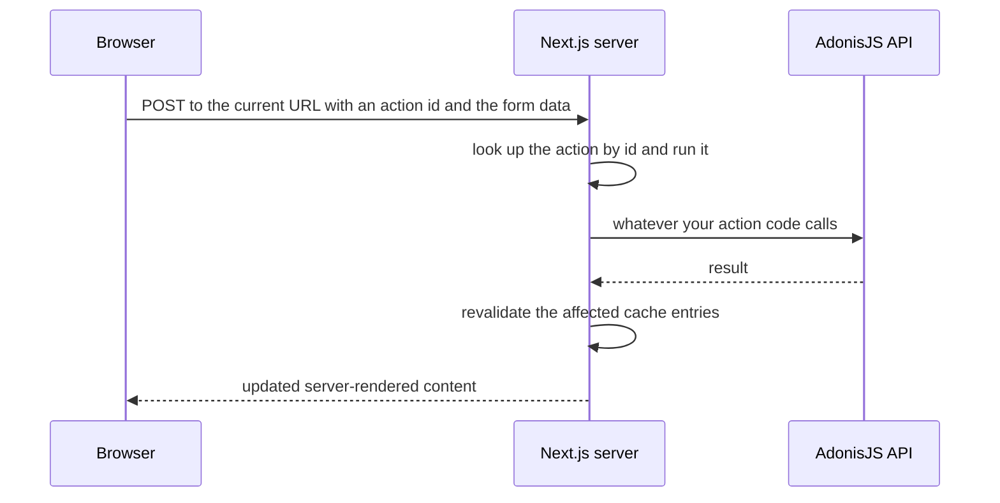

# Data Fetching and Mutations — Part 2

Part 1 was about reading. This part is about changing things, and it contains
the single most dangerous misunderstanding in modern Next.js.

That misunderstanding is about **server actions**. They let you write a
function in a component file, mark it, and call it from a form — with no route,
no endpoint and no `fetch` anywhere in sight. It feels like calling a local
function. It is not. It is an HTTP POST to a public URL, and if you read it as
a local function call you will ship something with no authentication check in
it, because local function calls do not need one.

The rest of the part is more comfortable ground: deciding between a server
action and your existing AdonisJS endpoint, refreshing the screen after a
write, and the double-submit problem you have already solved once on the server.

> **📌 In one line:** a server action is a public HTTP endpoint with a
> convenient syntax, so it needs authentication, authorization and validation
> exactly like any route you have ever written.

> **⬅️ This continues [Part 1](./04-data-fetching-and-mutations-part-1.md).**

## Table of Contents

1. [Server Actions: Code a Form Can Call](#server-actions-code-a-form-can-call)
2. [What Actually Happens When the Form Submits](#what-actually-happens-when-the-form-submits)
3. [A Server Action Is a Public HTTP Endpoint](#a-server-action-is-a-public-http-endpoint)
4. [Server Action or Your Existing API?](#server-action-or-your-existing-api)
5. [Revalidating After a Mutation](#revalidating-after-a-mutation)
6. [Advanced: Optimistic Updates](#advanced-optimistic-updates)
7. [Advanced: Double Submit and Idempotency](#advanced-double-submit-and-idempotency)
8. [Common Mistakes](#common-mistakes)
9. [Questions to Test Yourself](#questions-to-test-yourself)
10. [Related](#related)

---

## Server Actions: Code a Form Can Call

A server action is an `async` function marked with `'use server'`, either at
the top of the function or at the top of a file containing only actions.

```ts
// app/companies/[id]/projects/actions.ts
'use server'

import { revalidateTag } from 'next/cache'

export async function createProject(formData: FormData): Promise<void> {
  const name = formData.get('name')
  // ... create the project
  revalidateTag('projects')
}
```

```tsx
// app/companies/[id]/projects/new-project-form.tsx
import { createProject } from './actions'

export function NewProjectForm() {
  // No onSubmit, no fetch, no endpoint, no JSON.
  return (
    <form action={createProject}>
      <input name="name" required />
      <button type="submit">Create project</button>
    </form>
  )
}
```

Two genuine advantages come out of this. The form works before JavaScript has
loaded, because it is a real HTML form posting to a real URL — the framework
upgrades it to a smooth client-side submit once hydration finishes. And there
is no endpoint file to write, no route to name, no request body to parse.

> **💡 Tip:** `'use server'` and `'use client'` sound like a pair. They are
> not. `'use client'` marks a *boundary* for components. `'use server'` marks
> specific functions as remotely callable. Mixing the two up is common.

---

## What Actually Happens When the Form Submits



The important line is the first one. The browser makes a real HTTP POST. Next.js
generates a stable identifier for each action and routes the request to it. That
identifier is in the page, which means it is visible.

So anybody can send that POST. With any body. From anywhere, using `curl`,
without ever loading your page. That is not a flaw; it is what "callable from
the browser" means. But it has a consequence that the syntax actively hides.

> **⚠️ Warning:** nothing about the ergonomics changes the threat model. If you
> would not expose a route without an auth check, you must not write a server
> action without one.

---

## A Server Action Is a Public HTTP Endpoint

Here is the mistake, in the form it usually appears.

```ts
// ❌ BROKEN - no authentication, no authorization, no validation
'use server'

export async function deleteProject(projectId: string): Promise<void> {
  // The page that renders this button already checked the user is an admin,
  // so this is safe. <- This sentence is wrong.
  await db.delete(projects).where(eq(projects.id, projectId))
}
```

The page did check. The page is irrelevant. The attacker never visits the page;
they post directly to the action with any `projectId` they like. Every project
in every company is now deletable by anyone who found the action id.

```ts
// ✅ FIXED - the action authenticates, authorizes and validates for itself
'use server'

import { z } from 'zod'
import { cookies } from 'next/headers'
import { revalidateTag } from 'next/cache'

const schema = z.object({ projectId: z.string().uuid() })

export async function deleteProject(input: unknown): Promise<void> {
  // 1. Validate: the input arrived over the network and is untrusted.
  const { projectId } = schema.parse(input)

  // 2. Authenticate: who is this?
  const session = (await cookies()).get('session_token')?.value
  if (!session) throw new Error('unauthenticated')

  // 3. Authorize: may this user delete this project? Your API decides.
  await apiDelete(`/projects/${projectId}`, session)

  revalidateTag('projects')
}
```

Hold the three steps next to each other, because the order is not optional.

| Step | Question | Where the answer lives |
|---|---|---|
| Validate | is this input even the right shape? | a schema, at the top of the action |
| Authenticate | who is making this request? | the session cookie, read in the action |
| Authorize | may this user do this to this record? | your API or service layer, never the UI |

The distinction between the last two is the subject of
[Authentication versus Authorization](../../backend-fundamentals/06-authorization/01-authn-vs-authz.md).
A valid session proves identity. It proves nothing about permission. A server
action that checks only for a session is a server action that lets any logged-in
user delete any other company's projects.

> **📌 Remember:** "the button is only rendered for admins" is a user interface
> decision. Hiding a button removes it from the screen, not from the network.

---

## Server Action or Your Existing API?

You have an AdonisJS backend with validation, authorization, business rules,
logging and a mobile client. The question is not whether server actions are
good. It is whether a second place to write mutations is good for you.

| Consideration | Server action does the work | Server action calls your API |
|---|---|---|
| Where validation lives | duplicated in the frontend repo | once, in the backend |
| Where authorization lives | duplicated, and easy to forget | once, enforced for every client |
| Business rules on write | can be bypassed by other clients | always applied |
| Mobile and third-party clients | get a different code path | get the same code path |
| Audit logging | a second place to remember | already there |
| Round trips | one fewer | one more, inside your network |
| Who can review it | frontend reviewers | backend reviewers, who own the rules |
| Effort to add a new mutation | small at first, grows | small and constant |

**The recommendation for your situation: use server actions as a transport, not
as a place to put logic.** The action reads the session, validates the shape of
the input, calls your AdonisJS endpoint, and revalidates. The rules stay where
they already are.

```ts
// ✅ the shape to aim for - a thin action over your real backend
'use server'

export async function markInvoicePaid(input: unknown): Promise<void> {
  const { invoiceId } = markPaidSchema.parse(input)
  const session = (await cookies()).get('session_token')?.value
  if (!session) throw new Error('unauthenticated')

  // Authorization, business rules and audit logging all happen here, once.
  const invoice = await apiPost<Invoice>(`/invoices/${invoiceId}/pay`, session)

  revalidateTag(`company-${invoice.companyId}-invoices`)
}
```

This is the same argument as file 02's: one front door. A server action that
talks to your database directly is a second door into the same house, with its
own lock that somebody has to remember to fit.

Reach for a full server action with logic only when the mutation genuinely
belongs to the frontend and has no other client — dismissing a notification
banner, saving a UI preference, recording that a tour was completed.

---

## Revalidating After a Mutation

A write succeeded. The screen still shows the old data, because the server
rendered it earlier and something is holding that output.

```ts
// ❌ BROKEN - the write worked, the list did not change
'use server'
export async function archiveProject(input: unknown): Promise<void> {
  const { projectId } = schema.parse(input)
  await apiPost(`/projects/${projectId}/archive`, await readSession())
  // The projects list is still cached. The user archives, nothing moves,
  // they click again, and now you have two requests.
}
```

```ts
// ✅ FIXED - tell the cache which data is now wrong
'use server'
import { revalidateTag } from 'next/cache'

export async function archiveProject(input: unknown): Promise<void> {
  const { projectId } = schema.parse(input)
  const project = await apiPost<Project>(`/projects/${projectId}/archive`, await readSession())

  revalidateTag(`company-${project.companyId}-projects`)
  revalidateTag(`project-${projectId}`)
}
```

| Tool | Scope | Use when |
|---|---|---|
| `revalidateTag(tag)` | every cached fetch carrying that tag | the data appears on several pages |
| `revalidatePath(path)` | one route's cached output | you know exactly which page shows it |
| `router.refresh()` | the current route, from a client component | after a client-side write |
| Redirect to the new record | the destination renders fresh | after creating something |

The ordering rule from file 03 applies again: **write first, then invalidate.**
Invalidate before the write completes and you may refill the cache with the old
value, which is worse than not invalidating at all.

This is
[Invalidation in Practice](../../caching-and-background-jobs/01-caching-in-practice/03-invalidation-in-practice-part-1.md)
with a different cache underneath it. The hard part has never been the API
call; it is remembering every place that displays the data. Tags exist to make
that list shorter, and naming them after the resource rather than the page is
what makes them work.

> **⚠️ Warning:** when the same record is edited by your mobile app or an admin
> tool, no action of yours runs and nothing is invalidated. Pair on-demand
> revalidation with a time-based window for anything other clients can change.

---

## Advanced: Optimistic Updates

Marking a task complete takes 300 milliseconds. The user clicks, and for 300
milliseconds nothing happens. Clicking again feels reasonable to them.

An optimistic update shows the result immediately, before the server confirms,
and rolls back if the request fails.

```tsx
'use client'
import { useOptimistic, useTransition } from 'react'

export function TaskRow({ task }: { task: Task }) {
  const [optimistic, setOptimistic] = useOptimistic(task)
  const [isPending, startTransition] = useTransition()

  function complete(): void {
    startTransition(async () => {
      setOptimistic({ ...task, status: 'done' })  // instant, local
      await completeTask({ taskId: task.id })     // the server action
      // On failure React discards the optimistic value automatically.
    })
  }

  return (
    <button onClick={complete} disabled={isPending}>
      {optimistic.status === 'done' ? 'Done' : 'Mark done'}
    </button>
  )
}
```

Hook names and exact behaviour here have moved between React and Next.js
versions; check your version's docs before copying.

Use optimistic updates where the action almost always succeeds and the result
is easy to picture: toggling a checkbox, archiving a row, adding a comment. Do
not use them where failure is likely or the result is a surprise — a payment, a
permission change, anything where "it looked like it worked" is harmful.

| Good candidate | Bad candidate |
|---|---|
| Mark task done | Charge a card |
| Archive a project | Change a user's role |
| Add a comment | Send an invoice to a client |
| Toggle a notification setting | Delete a company |

---

## Advanced: Double Submit and Idempotency

[Forms and User Input](../01-react-fundamentals/04-forms-and-user-input-part-1.md)
covered the browser side: disable the button while the request is in flight.
Keep doing that. It handles the ordinary case of an impatient user.

It does not handle the rest. A flaky connection retries the POST. The user
refreshes a page that was mid-submit. A network blip means your action never
saw the response but the server did the work. In every one of those, the button
state is irrelevant — the second request is real and your server must deal with
it.

```ts
// ✅ the client sends a key; the server makes the operation safe to repeat
'use server'

export async function createInvoice(input: unknown): Promise<Invoice> {
  const { companyId, lines, requestKey } = createInvoiceSchema.parse(input)
  const session = await readSession()

  // The key is generated once in the browser, before the first attempt,
  // and reused by every retry of this same user intention.
  return apiPost<Invoice>(`/companies/${companyId}/invoices`, session, {
    body: { lines },
    headers: { 'Idempotency-Key': requestKey },
  })
}
```

The server stores the key with the result. A repeat with the same key returns
the original invoice instead of creating a second one. That design, and the
edge cases it has, is
[Idempotency](../../system-design/reliability/idempotency.md) — written for
your API, and applying unchanged here because a server action *is* a call to
your API with extra steps.

> **📌 Remember:** disabling a button is a user experience improvement.
> Idempotency is a correctness guarantee. Only one of the two survives a bad
> network.

---

## Common Mistakes

| Mistake | Why it is wrong | Do this instead |
|---|---|---|
| Treating a server action as a local function call | It is a public HTTP POST anyone can send | Validate, authenticate and authorize inside it |
| Relying on a hidden button for safety | Hiding a control removes it from the screen, not the network | Check permission in the action |
| Checking the session and stopping there | A session proves identity, not permission | Authorize the specific record too |
| Reimplementing business rules in an action | Mobile and other clients bypass them | Call your API and keep rules in one place |
| Forgetting to revalidate after a write | The user sees stale data and clicks again | `revalidateTag` after the write succeeds |
| Revalidating before the write finishes | You may re-cache the old value | Await the write, then invalidate |
| Tagging caches by page rather than resource | You miss every other page showing the data | Tag by resource and id |
| Optimistic updates on payments or permissions | "It looked like it worked" is harmful there | Show a real pending state |
| Relying on a disabled button to stop duplicates | Retries and refreshes ignore it | Send an idempotency key |

---

## Questions to Test Yourself

1. Explain what actually travels over the network when a form calls a server
   action, and why that makes it a public endpoint.
2. A colleague says the delete action is safe because the button only renders
   for admins. Write the two-sentence reply that changes their mind.
3. List the three checks every server action needs, in order, and say where the
   answer to each one lives.
4. Give three reasons, from your own stack, to make a server action a thin
   wrapper over your AdonisJS API rather than a place for logic.
5. Name a mutation that genuinely belongs in a server action with no API call,
   and say what makes it different.
6. Why must revalidation happen after the write and not before?
7. Your mobile app changes an invoice. Which revalidation mechanism will not
   fire, and what covers that gap?
8. Give two failures that a disabled submit button does not prevent, and name
   the mechanism that does.

---

## Related

- [Data Fetching and Mutations — Part 1](04-data-fetching-and-mutations-part-1.md)
  — reading data, forwarding the session, and waterfalls.
- [backend-fundamentals/06-authorization/01-authn-vs-authz.md](../../backend-fundamentals/06-authorization/01-authn-vs-authz.md)
  — the identity-versus-permission distinction every action must respect.
- [caching-and-background-jobs/01-caching-in-practice/03-invalidation-in-practice-part-1.md](../../caching-and-background-jobs/01-caching-in-practice/03-invalidation-in-practice-part-1.md)
  — the same invalidation problem, with Redis instead of the data cache.
- [system-design/reliability/idempotency.md](../../system-design/reliability/idempotency.md)
  — making a repeated write safe, which a disabled button cannot do.
- [React Fundamentals — Forms and User Input Part 1](../01-react-fundamentals/04-forms-and-user-input-part-1.md)
  — the browser-side half of the double-submit problem.
