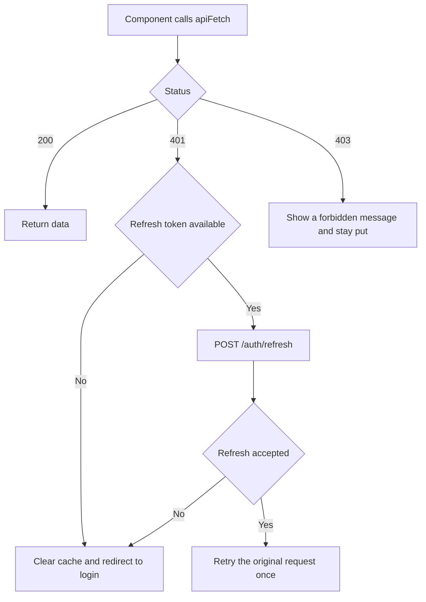
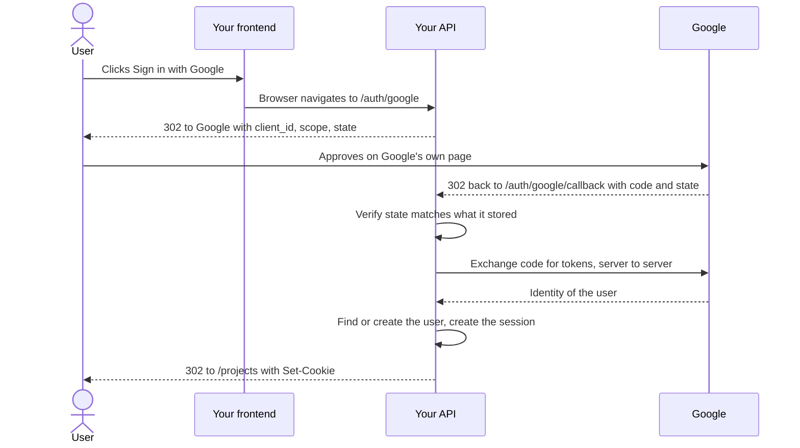

# Auth Flow End to End — Part 2

Part 1 ended with a valid credential sitting in the browser and travelling
correctly on every request. That is the hard half of the security. This part is
the half you actually write code for: hiding pages from logged-out users,
knowing who is logged in, reacting when the credential dies mid-session, and
logging out in a way that really ends the session.

There is one idea in here that matters more than all the code: **nothing you do
in the browser protects anything.** The browser is the attacker's computer. Your
route guard is a convenience for honest users. Hold on to that while you read.

> **⬅️ This continues [Part 1](./01-auth-flow-end-to-end-part-1.md).**

> **📌 In one line:** client-side auth is user experience, server-side auth is
> security — so build the nice experience, but never let it be the only check.

## Table of Contents

1. [Protecting Routes in the Browser](#protecting-routes-in-the-browser)
2. [BROKEN vs FIXED: the Guard That Protected Nothing](#broken-vs-fixed-the-guard-that-protected-nothing)
3. [Reading the Current User](#reading-the-current-user)
4. [The Stale-After-Logout Problem](#the-stale-after-logout-problem)
5. [Handling 401 in One Place](#handling-401-in-one-place)
6. [Refresh Tokens and Rotation](#refresh-tokens-and-rotation)
7. [Logout That Actually Works](#logout-that-actually-works)
8. [Advanced: Server Components vs Client Components](#advanced-server-components-vs-client-components)
9. [Advanced: Social Login's Redirect Round Trip](#advanced-social-logins-redirect-round-trip)
10. [Common Mistakes](#common-mistakes)
11. [Questions to Test Yourself](#questions-to-test-yourself)
12. [Related](#related)

---

## Protecting Routes in the Browser

The requirement is simple: a logged-out user who opens `/projects` should land
on `/login` instead, and come back to `/projects` after signing in.

The shape is always the same. Ask who the user is, show nothing useful while you
do not know, then either render or redirect.

```tsx
type AuthState =
  | { status: 'loading' }
  | { status: 'authenticated'; user: CurrentUser }
  | { status: 'anonymous' }

function RequireAuth({ children }: { children: React.ReactNode }) {
  const auth = useAuth()
  const router = useRouter()
  const pathname = usePathname()

  useEffect(() => {
    if (auth.status === 'anonymous') {
      // Keep where they wanted to go, so login can send them back.
      router.replace(`/login?next=${encodeURIComponent(pathname)}`)
    }
  }, [auth.status, pathname, router])

  if (auth.status === 'loading') return <PageSkeleton />
  if (auth.status === 'anonymous') return null
  return <>{children}</>
}
```

Three details that are easy to get wrong:

- **`replace`, not `push`.** With `push`, the browser Back button returns the
  user to the protected page they were just bounced off, and they bounce again.
  It looks broken.
- **The third state is not optional.** Before the first `/me` response you do
  not know whether the user is logged in. Rendering the app during that window
  produces a flash of the dashboard; redirecting during it logs out a perfectly
  valid user on every page refresh.
- **Keep the destination.** `?next=/projects/14/tasks` is the difference between
  a login that feels designed and one that dumps everyone on the home page.

---

## BROKEN vs FIXED: the Guard That Protected Nothing

This is the most important section in the whole folder.

```tsx
// ❌ BROKEN — this is not security, and the API below it has no check at all
function InvoiceAdminPage() {
  const { user } = useAuth()
  if (user.role !== 'admin') return <Redirect to="/projects" />
  return <InvoiceTable />
}
```

```ts
// ❌ BROKEN — the matching endpoint, trusting that the UI already checked
router.get('/v1/invoices', async ({ request }) => {
  return Invoice.query().where('company_id', request.input('company_id'))
})
```

Why this is not a bug but an incident:

- The guard runs in **JavaScript on the user's machine**. They can open
  devtools, set a breakpoint, and change `user.role` to `'admin'`.
- They do not even need to. `curl https://api.acme.com/v1/invoices?company_id=7`
  never loads your React app. The guard is not involved.
- The component was downloaded to their computer before any check ran. Anything
  hard-coded in it — an internal URL, a feature name, a threshold — is readable.

```tsx
// ✅ FIXED — the client redirect stays, as UX; the server decides
function InvoiceAdminPage() {
  const { user } = useAuth()
  // Purely so an ordinary user does not see a page that will 403 anyway.
  if (user.role !== 'admin') return <Redirect to="/projects" />
  return <InvoiceTable />
}
```

```ts
// ✅ FIXED — authorization where it cannot be edited: on the server
router.get('/v1/invoices', async ({ auth, bouncer }) => {
  const user = auth.getUserOrFail()
  await bouncer.authorize('viewCompanyInvoices')
  // Scope by the session's company, never by a client-supplied id.
  return Invoice.query().where('company_id', user.companyId)
})
```

> **⚠️ Warning:** a client-side redirect is a **convenience**, not a control.
> The honest test: if someone deleted your entire frontend and called the API
> with `curl`, would your data still be safe? If the answer is no, the check is
> in the wrong place.

The second `✅` line also fixes a separate flaw: `company_id` came from the
client. Even an authenticated user could read another company's invoices by
changing one number. That is **IDOR** — insecure direct object reference — and
it is covered in
[03-ownership-abac-and-multi-tenancy-part-1.md](../../backend-fundamentals/06-authorization/03-ownership-abac-and-multi-tenancy-part-1.md).
The distinction between the two checks is exactly
[01-authn-vs-authz.md](../../backend-fundamentals/06-authorization/01-authn-vs-authz.md).

---

## Reading the Current User

With an `HttpOnly` cookie, your JavaScript cannot read the credential, so it
cannot know who the user is by inspecting storage. It has to ask.

One endpoint answers everything: `GET /api/v1/me`. It returns the user the
cookie resolves to, or 401.

```ts
export type CurrentUser = {
  id: string
  email: string
  name: string
  role: 'owner' | 'admin' | 'member'
  companyId: string
  permissions: string[]
}

export async function fetchCurrentUser(): Promise<CurrentUser | null> {
  const response = await apiFetch('/me')
  if (response.status === 401) return null // anonymous is a normal answer
  if (!response.ok) throw new Error(`Unexpected ${response.status} from /me`)
  return (await response.json()) as CurrentUser
}
```

Note that 401 is **not an error here**. On `/me` it is a valid answer meaning
"nobody". Everywhere else in your app a 401 means "your session died" — same
status, different meaning, because the question was different.

Where to hold the result: one place, high in the tree, fetched once.

| Option | When it fits | Cost |
|---|---|---|
| React context around the app | Small app, one user object | You write the caching yourself |
| A data library cache, key `['me']` | Most apps | A dependency, already present if you fetch data |
| A server component reading the cookie | Next.js App Router | No loading state at all on first paint |
| Prop-drilling from the page | Two or three components deep | Breaks down quickly |

For most teams the answer is: fetch `/me` with your data-fetching library under
a stable key, and expose a `useAuth()` hook that reads that cache. Every
component gets the same object, one request is made, and you get invalidation
for free — which the next section needs.

---

## The Stale-After-Logout Problem

Your cached user object is a copy. The truth lives on the server. They drift
apart, and the drift is visible.

```text
10:00  User logs in. /me cached: { role: 'admin' }.
10:05  An owner demotes them to 'member' in another tab.
10:05  Their cached object still says 'admin'.
       The "Delete project" button is still on screen.
10:06  They click it. The API returns 403.
```

Nothing was compromised — the server refused, exactly as designed. But the user
saw a button that lied to them.

The same thing happens in reverse after logout in another tab: this tab still
shows a dashboard full of data for a session that no longer exists, until
something triggers a request.

Three fixes, in order of effort:

1. **Invalidate `['me']` after anything that could change it** — a role change,
   a company switch, a plan upgrade. One line after the mutation.
2. **Refetch `/me` on window focus.** Most data libraries do this by default.
   Coming back to the tab silently corrects the picture.
3. **Treat any 403 as a signal**, not just a message. If the server refuses
   something the UI offered, the UI's idea of the user is out of date, so
   invalidate it.

> **💡 Tip:** this is cache invalidation, the same problem as everywhere else in
> the stack. Your browser cache of `/me` is not different in kind from a Redis
> cache of the same row — see
> [caching-and-background-jobs/](../../caching-and-background-jobs/).

---

## Handling 401 in One Place

Sessions end while people are using the app: the cookie expires, an admin
revokes the session, the server restarts with a new signing key. Every request
in your app can return 401 at any moment.

Handling that in each component is hopeless. Handle it in the one function all
requests already go through.

```ts
let redirecting = false

export async function apiFetch(path: string, init: RequestInit = {}): Promise<Response> {
  const response = await fetch(`${API}${path}`, {
    ...init,
    credentials: 'include',
    headers: { 'Content-Type': 'application/json', ...init.headers },
  })

  // /me asks "who am I" — 401 there is an answer, not a failure.
  if (response.status === 401 && path !== '/me' && !redirecting) {
    redirecting = true // ten parallel 401s must not cause ten redirects
    const next = encodeURIComponent(window.location.pathname)
    window.location.assign(`/login?reason=session_expired&next=${next}`)
  }

  return response
}
```



Two things that look small and are not. The `redirecting` flag stops a page with
eight parallel queries from firing eight navigations. And `reason=session_expired`
lets the login page say *"Your session expired, please sign in again"* instead
of showing a blank form to someone who thought they were already logged in.

---

## Refresh Tokens and Rotation

If you use tokens rather than server sessions, you face a trade-off: a long
lifetime is convenient and dangerous, a short one is safe and annoying. The
standard answer is two tokens.

| Token | Lifetime | Stored | Sent with | Purpose |
|---|---|---|---|---|
| Access | 5–15 minutes | Memory, or an `HttpOnly` cookie | Every API request | Proves identity |
| Refresh | Days or weeks | `HttpOnly` cookie, `Path=/auth/refresh` | Only the refresh call | Buys a new access token |

The short access lifetime is what makes theft survivable: a stolen access token
is useless within minutes. The refresh token is long-lived, so it is kept where
JavaScript cannot touch it and sent to exactly one endpoint.

**Rotation** means every refresh issues a *new* refresh token and invalidates the
old one. That gives you theft detection: if an old refresh token is ever used
again, either the attacker or the real user is replaying it, so you revoke the
whole family and force a fresh login.

```ts
let refreshInFlight: Promise<boolean> | null = null

async function refreshSession(): Promise<boolean> {
  // Share one refresh across all callers, or you fire N rotations at once
  // and N-1 of them look like token replay to the server.
  refreshInFlight ??= (async () => {
    const response = await fetch(`${API}/auth/refresh`, {
      method: 'POST',
      credentials: 'include',
    })
    return response.ok
  })().finally(() => { refreshInFlight = null })

  return refreshInFlight
}
```

> **⚠️ Warning:** the single-flight guard is not a nicety. Without it, a
> dashboard that fires six requests at once on a dead access token sends six
> refreshes with the same token. With rotation on, five of them are replays, and
> a strict server logs the user out for suspected theft.

The token mechanics are in
[04-jwt-part-2.md](../../backend-fundamentals/05-authentication/04-jwt-part-2.md).

---

## Logout That Actually Works

Logout is where a surprising number of applications are quietly broken.

```ts
// ❌ BROKEN — the session is still perfectly valid on the server
function logout(): void {
  setUser(null)
  queryClient.clear()
  router.push('/login')
}
```

The screen says signed out. The cookie is still in the jar, the session row is
still in the database, and anyone who replays that cookie is still logged in.
On a shared computer, pressing Back may be enough.

```ts
// ✅ FIXED — the server ends the session; the client just tidies up after
async function logout(): Promise<void> {
  try {
    // Server deletes the session row and sends an expiring Set-Cookie.
    await apiFetch('/auth/logout', { method: 'POST' })
  } finally {
    // Runs even if the network failed, so the UI never gets stuck signed in.
    queryClient.clear()       // drop every cached response, not just the user
    window.location.assign('/login') // full reload clears in-memory state too
  }
}
```

Four points worth stating plainly:

- **Only the server can delete an `HttpOnly` cookie.** Your JavaScript cannot
  see it, so it cannot clear it. The server returns
  `Set-Cookie: session=; Max-Age=0` with the same `Path` and `Domain`.
- **Delete the session record too.** With server sessions, clearing the cookie
  without deleting the row leaves a valid credential that a copy can still use.
- **Stateless JWTs cannot be deleted**, which is their real cost. You need a
  deny list until expiry, or short lifetimes plus refresh revocation.
- **Clear the whole client cache**, not just the user. Another user signing in
  on the same machine must not see the previous one's invoice list.

> **📌 Remember:** logging out is a server action with a client side effect. If
> your logout function never makes a request, it is not a logout.

---

## Advanced: Server Components vs Client Components

In the Next.js App Router, a component may run on the server during the request.
That changes where the cookie is readable.

| | Server component | Client component |
|---|---|---|
| Reads an `HttpOnly` cookie | **Yes**, through the request | Never |
| Calls your API | Directly, server to server | Over the network, through the browser |
| Needs a loading state for the user | No, it has the user before rendering | Yes |
| Can hold `useState` or `useEffect` | No | Yes |
| Safe to read a secret in | Yes | Never — it ships to the browser |

```tsx
// app/projects/page.tsx — a server component
import { cookies } from 'next/headers'
import { redirect } from 'next/navigation'

export default async function ProjectsPage() {
  const session = (await cookies()).get('session')
  if (!session) redirect('/login') // happens before any HTML is sent

  const user = await loadUserFromSession(session.value)
  const projects = await listProjectsForCompany(user.companyId)
  return <ProjectList projects={projects} currentUser={user} />
}
```

This is strictly better UX than the client guard: no flash, no loading state, no
unauthenticated HTML ever reaching the browser. It is still **not** your
authorization boundary. The data endpoints behind it must enforce the same rule,
because a client component elsewhere can call them directly.

> **💡 Tip:** pass the user *down* as a prop from the server component instead of
> refetching `/me` in the client. One source, no second request, no skeleton.

The rendering model behind this split is covered in
[02-server-and-client-components-part-1.md](../02-nextjs-essentials/02-server-and-client-components-part-1.md).

---

## Advanced: Social Login's Redirect Round Trip

"Sign in with Google" looks like a button and is actually a navigation away from
your app and back. The important part: **the token never passes through your
JavaScript.**



Three things to notice:

- The frontend's entire contribution is one link. It never handles a code or a
  token. The code-for-token exchange uses a client secret, which must never be
  in your bundle.
- **`state`** is a random value your server generates, stores, and checks on the
  way back. It is CSRF protection for the login flow itself.
- The flow ends with the **same session cookie** as a password login. From the
  next request onward, nothing downstream knows or cares how the user signed in.

The protocol details are in
[05-oauth2-and-social-login-part-1.md](../../backend-fundamentals/05-authentication/05-oauth2-and-social-login-part-1.md)
and [part 2](../../backend-fundamentals/05-authentication/05-oauth2-and-social-login-part-2.md).

---

## Common Mistakes

| Mistake | Why it is wrong | Do this instead |
|---|---|---|
| Treating a client-side guard as security | It runs on the attacker's machine and `curl` skips it entirely | Guard for UX, authorize on every endpoint |
| No third "unknown" auth state | Either a flash of the dashboard, or logged-out on every refresh | Model `loading`, `authenticated`, `anonymous` |
| `router.push` for the login redirect | Back returns to the protected page and bounces again | Use `replace` |
| Logout that only clears client state | The cookie and the session row survive; the credential still works | `POST /auth/logout`, then clear the cache |
| Refreshing on every parallel 401 | With rotation, the extra calls look like token replay | One shared in-flight refresh promise |
| Caching `/me` forever | A demoted user keeps seeing admin buttons until they reload | Invalidate on relevant mutations and on window focus |
| Trusting an id from the client to scope a query | A user edits one number and reads another company's data | Scope by the session's `companyId` |
| Only clearing the user object on logout | The next user on that machine sees the cached invoice list | Clear the entire client cache |

## Questions to Test Yourself

1. Your `RequireAuth` has only two states. Describe both bugs that causes.
2. Someone removes a client-side admin guard with devtools. What, exactly,
   should stop them from reading the data — and where does it live?
3. Why is 401 a normal answer from `/me` but an emergency from `/invoices`?
4. A user is demoted while logged in. Walk through what they see, and why
   nothing is actually compromised.
5. Why can your JavaScript not delete the session cookie, and what must happen
   instead?
6. What does refresh-token rotation detect, and why does it break without a
   single-flight guard?
7. A server component redirects an anonymous user before any HTML is sent. Does
   that make the API endpoint's check unnecessary? Why not?
8. In the OAuth round trip, why must the code-for-token exchange happen on your
   server rather than in the browser?

## Related

- [01-auth-flow-end-to-end-part-1.md](./01-auth-flow-end-to-end-part-1.md) —
  where the credential lives, CSRF, and CORS with credentials.
- [01-authn-vs-authz.md](../../backend-fundamentals/06-authorization/01-authn-vs-authz.md)
  — the distinction the guard section depends on.
- [03-ownership-abac-and-multi-tenancy-part-1.md](../../backend-fundamentals/06-authorization/03-ownership-abac-and-multi-tenancy-part-1.md)
  — scoping a query by the session instead of by client input.
- [05-oauth2-and-social-login-part-1.md](../../backend-fundamentals/05-authentication/05-oauth2-and-social-login-part-1.md)
  — the protocol behind the redirect round trip.
- [04-jwt-part-2.md](../../backend-fundamentals/05-authentication/04-jwt-part-2.md)
  — expiry, refresh and revocation on the server.
- [02-loading-error-and-empty-states.md](./02-loading-error-and-empty-states.md)
  — the 401 and 403 handling here, generalised to every status.
