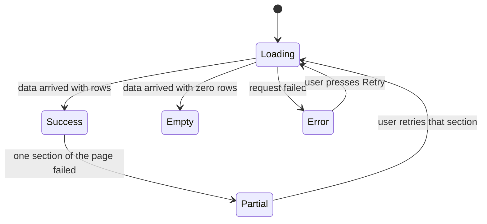
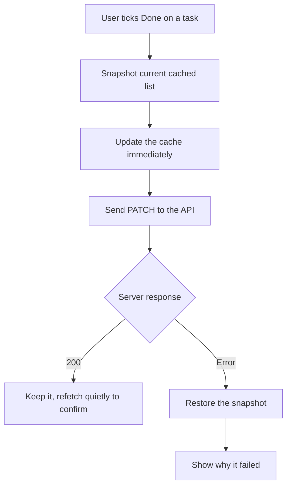

# Loading, Error and Empty States

Your API returns the right JSON. Your component renders it. The ticket is done.
Then a real user opens the page on hotel wi-fi, on a brand-new account, three
seconds after your database started failing over — and sees a white rectangle.
Nothing is broken in the sense your tests would show. Everything is broken in
the sense that matters.

This file is about the parts of a screen that exist only when something is not
normal. On the server you already do this well: an error taxonomy, a typed error
body, logs with a correlation id. This is the other end of that work — the half
that turns a careful `409` into something a human can act on.

> **📌 In one line:** a feature is finished when all five of its states are
> designed, not when the happy path renders.

## Table of Contents

1. [The States You Forget Are the Ones Users Hit](#the-states-you-forget-are-the-ones-users-hit)
2. [The Five States of Every Data Screen](#the-five-states-of-every-data-screen)
3. [Why Empty and Error Are the Ones That Get Skipped](#why-empty-and-error-are-the-ones-that-get-skipped)
4. [Loading Done Well](#loading-done-well)
5. [Error States That Help](#error-states-that-help)
6. [BROKEN vs FIXED: the Error That Threw Away the Answer](#broken-vs-fixed-the-error-that-threw-away-the-answer)
7. [Showing the request_id Is a Support Feature](#showing-the-request_id-is-a-support-feature)
8. [One Status Code, One UI Behaviour](#one-status-code-one-ui-behaviour)
9. [Optimistic Updates and Rollback](#optimistic-updates-and-rollback)
10. [Network Reality](#network-reality)
11. [Advanced: Error Boundaries vs Data-Fetching Errors](#advanced-error-boundaries-vs-data-fetching-errors)
12. [Advanced: Seeing Your Frontend Errors](#advanced-seeing-your-frontend-errors)
13. [Common Mistakes](#common-mistakes)
14. [Questions to Test Yourself](#questions-to-test-yourself)
15. [Related](#related)

---

## The States You Forget Are the Ones Users Hit

Think about a lift with a broken floor display. The lift works perfectly. It
still feels broken, because for ten seconds you have no idea whether it is
moving or stuck. User confidence does not come from your code being correct; it
comes from the screen saying what is happening. And the states you skip are not
rare edge cases:

- **Every user** sees the empty state — the first screen of their first session.
- **Every user on a train** sees the slow and failed states.

> **📌 Remember:** you test the happy path constantly, with a seeded database on
> localhost. That is precisely why it is the state least likely to be wrong —
> and the others are a user's first impression.

---

## The Five States of Every Data Screen

Any screen that loads data from your API has five states. Name them on the
ticket, before you write the component.



| State | What it means | What the user must see | SaaS example |
|---|---|---|---|
| **Loading** | The request is in flight | The shape of what is coming | Grey skeleton rows where projects will be |
| **Empty** | Success, zero rows | Why it is empty and what to do next | "No projects yet" plus a Create project button |
| **Partial** | Some data arrived, some failed | The good data, plus a scoped failure | Invoice list renders; the totals widget says it could not load |
| **Error** | The request failed | What happened, and a way forward | "We could not load your invoices" plus Retry |
| **Success** | Data arrived | The data itself | The project list |

Two distinctions people collapse and should not. **Empty is not an error:** a
`200` with `[]` is a complete success, and a red box on a brand-new account
tells the user your product is broken on their first screen. **Empty is not
loading:** if both render as nothing, a slow request and a new account look
identical, and the user cannot tell whether to wait or to act.

```tsx
// ❌ BROKEN — four states collapsed into two, and empty looks like loading
if (!projects) return null
return <ProjectTable rows={projects} />

// ✅ FIXED — every state has its own answer
if (query.isPending) return <ProjectTableSkeleton rows={5} />
if (query.isError) return <LoadFailed error={query.error} onRetry={query.refetch} />
if (query.data.length === 0) return <NoProjectsYet onCreate={openCreate} />
return <ProjectTable rows={query.data} />
```

---

## Why Empty and Error Are the Ones That Get Skipped

Not laziness. Three structural reasons. **Your dev database is never empty** —
it has seed data from day one, so you can build a feature for a week and never
see its empty state. **Your local API never fails** — same machine, no latency,
no network, so failure takes deliberate effort to reproduce. **Designs show one
state** — the mockup has a full table, nobody drew the other four, so nobody
built them.

What a user concludes from a blank screen, in order:

```text
1. "It is still loading."     (waits a few seconds)
2. "Did my click register?"   (clicks again — now you have a double submit)
3. "This page is broken."     (reloads)
4. "This product is broken."  (tells a colleague, or opens a ticket)
```

Step 2 is worth dwelling on. A missing loading state does not only confuse — it
produces duplicate requests, which is how you get two identical invoices.

> **💡 Tip:** add two commands to your project — one that empties the dev
> database, one that makes your API return a 500. If seeing those states takes
> one command, people handle them. If it takes twenty minutes, they do not.

---

## Loading Done Well

A **skeleton** is a grey outline shaped like the content that is coming. A
**spinner** is a rotating symbol that says only "something is happening".

| | Skeleton | Spinner |
|---|---|---|
| Tells the user what is coming | Yes | No |
| Reserves the final layout | Yes | No |
| Good for | Lists, tables, cards, detail pages | Buttons, small inline actions |
| Cost to build | Medium, must match the layout | Almost none |
| Feels | Faster than it is | Slower than it is |

**Layout shift** is why skeletons win for page content. If loading renders a
40-pixel spinner and success an 800-pixel table, everything below jumps when the
data arrives, and a user about to click one button clicks another. A skeleton
that occupies the real height removes the jump.

Two timing rules matter more than the choice of indicator:

- **Under about 200 ms, show nothing.** A spinner that appears and vanishes in
  100 ms reads as a flicker, and a flicker reads as a glitch.
- **Once shown, keep it for a minimum.** If it appears at 200 ms and the data
  arrives at 230 ms, hold it to about 500 ms. A flash is worse than a short,
  steady wait.

```tsx
function useDelayedPending(isPending: boolean, delayMs = 200): boolean {
  const [visible, setVisible] = useState(false)
  useEffect(() => {
    if (!isPending) { setVisible(false); return }
    const timer = setTimeout(() => setVisible(true), delayMs)
    return () => clearTimeout(timer) // fast response: nothing is ever shown
  }, [isPending, delayMs])
  return visible
}
```

Next.js moves much of this into the framework: `loading.tsx` and Suspense
boundaries let the server stream a skeleton immediately and swap in content as
each part resolves. See
[03-rendering-strategies-part-2.md](../02-nextjs-essentials/03-rendering-strategies-part-2.md)
for how streaming changes where the loading state is declared.

---

## Error States That Help

Three rules, and the third is non-negotiable. **Say what failed, in the user's
terms** — not "Request failed with status code 500" but "We could not load your
invoices". **Offer the next step** — usually Retry, sometimes "go back" or "this
invoice was already paid, reload the page". **Never render internals** — no
stack trace, no SQL, no file path, no exception class. Your server strips those,
per
[03-client-facing-error-responses-part-1.md](../../backend-fundamentals/07-error-handling/03-client-facing-error-responses-part-1.md),
so do not reintroduce them by dumping the whole JSON on screen.

Your API already returns a precise, safe shape. Type it once, consume it
everywhere:

```ts
export type ApiFieldError = {
  field: string   // "email" or "items[2].quantity"
  code: string    // "INVALID_FORMAT"
  message: string // "Must be a valid email address."
}

export type ApiError = {
  error: {
    code: string       // "VALIDATION_FAILED" — branch on this, never on message
    message: string    // safe, one sentence, showable to a user
    details?: ApiFieldError[]
    request_id: string // the join key into your logs
  }
}

export class ApiRequestError extends Error {
  constructor(
    readonly status: number,
    readonly code: string,
    readonly requestId: string,
    message: string,
    readonly fieldErrors: ApiFieldError[] = [],
  ) { super(message) }
}
```

```ts
export async function parseError(response: Response): Promise<ApiRequestError> {
  try {
    const { error } = (await response.json()) as ApiError
    return new ApiRequestError(response.status, error.code, error.request_id,
      error.message, error.details ?? [])
  } catch {
    // A proxy timeout or a 502 from the load balancer is not your JSON.
    return new ApiRequestError(response.status, 'NETWORK_ERROR', '',
      'We could not reach the server. Please try again.')
  }
}
```

> **⚠️ Warning:** branch on `code`, never on `message`. A copy edit to a message
> is a product decision; if your UI compares strings, it becomes a deploy that
> breaks the frontend.

---

## BROKEN vs FIXED: the Error That Threw Away the Answer

Your server validated every field, returned `422`, and listed exactly what was
wrong. Then the client deleted the answer.

```tsx
// ❌ BROKEN — a precise, per-field answer reduced to one useless sentence
async function onSubmit(values: CreateInvoiceInput): Promise<void> {
  try {
    await apiFetch('/invoices', { method: 'POST', body: JSON.stringify(values) })
  } catch {
    toast.error('Something went wrong')
  }
}
```

The user has an eight-field form and no idea which field is wrong. They guess,
resubmit, and guess again.

```tsx
// ✅ FIXED — field errors land under their fields, the rest is shown honestly
async function onSubmit(values: CreateInvoiceInput): Promise<void> {
  const response = await apiFetch('/invoices', {
    method: 'POST', body: JSON.stringify(values),
  })
  if (response.ok) { onSuccess(); return }

  const error = await parseError(response)
  if (error.status === 422) {
    // Each entry carries the exact field path, so it lands in the right place.
    for (const f of error.fieldErrors) form.setError(f.field, { message: f.message })
    return // the form shows the detail; no toast needed
  }
  setFormError({ message: error.message, requestId: error.requestId })
}
```

The difference is not effort. It is whether you treat the error body as
information or as noise.


---

## Showing the request_id Is a Support Feature

Your error body carries a `request_id`, and the same value is on every log line
for that request — the whole point of
[03-correlation-ids-and-tracing.md](../../backend-fundamentals/08-logging-and-observability/03-correlation-ids-and-tracing.md).
If you never render it, you break that chain at the last step.

```text
Without it: "I tried to save an invoice yesterday afternoon and it failed."
            → you search an hour of logs for a user you must first identify.

With it:    "It says req_01HQ4Z8FVX9T2N."
            → one search, exact request, full context, thirty seconds.
```

Render it quietly — small, grey, under the message, easy to copy:

```tsx
<div role="alert">
  <p>{error.message}</p>
  <button onClick={onRetry}>Try again</button>
  {error.requestId !== '' && <p className="support-ref">Reference: <code>{error.requestId}</code></p>}
</div>
```

> **💡 Tip:** this is safe to show. The `request_id` is a random identifier, not
> a secret. It reveals nothing about your system and turns a vague complaint
> into a searchable fact.

---

## One Status Code, One UI Behaviour

Every status from
[04-status-codes.md](../../backend-fundamentals/01-http-foundations/04-status-codes.md)
means something specific. Treating them all as "error" throws that away.

| Status | Meaning | What the UI should do |
|---|---|---|
| **401** | Not authenticated | Redirect to login with `?next=`, say the session expired |
| **403** | Authenticated, not allowed | **Do not redirect.** Explain what is not permitted and who can grant it |
| **404** | Resource does not exist | A not-found panel with a link back to the list, not a crash |
| **409** | Conflict with current state | Explain the conflict and offer to reload — "this invoice was already paid" |
| **422** | Validation failed | Field errors under each field; keep everything the user typed |
| **429** | Rate limited | Disable the action, show the wait from `Retry-After`, retry automatically after it |
| **500 / 502 / 503** | Server problem | Apologise, show `request_id`, offer Retry; back off between attempts |

The 401 versus 403 distinction gets collapsed most often and produces the worst
bug in this table. Redirecting a 403 to login sends a correctly logged-in user
to a form they already filled in; they sign in, return, hit 403 again, and
conclude the product is broken. **401 means "who are you"; 403 means "not
you".**

```ts
export function retryDelayMs(status: number, attempt: number, retryAfterSeconds = 0): number | null {
  if (status === 429) return retryAfterSeconds * 1000
  if (status < 500) return null              // 4xx fails identically forever
  if (attempt >= 3) return null
  return Math.min(1000 * 2 ** attempt, 8000) // 1s, 2s, 4s
}
```

Retrying a `422` is pointless — the same body fails the same way. Retrying a
`503` is sensible, because the cause is time. The status tells you which.

---

## Optimistic Updates and Rollback

An **optimistic update** means showing the result before the server confirms it:
tick the checkbox now, send the request in the background, undo it if the server
disagrees. It removes the wait from actions that rarely fail.



The snapshot is the non-negotiable part. Without it you cannot roll back, and a
failed request leaves the screen showing something that never happened.

Use it for low-stakes, high-frequency, reversible actions: ticking a task,
renaming a project, toggling a notification setting. Do not use it when being
wrong costs the user something real:

- **Anything involving money.** Never show "Payment successful" before the
  server says so. Payments fail for reasons no client can predict — declined
  card, insufficient funds, fraud check — and a rolled-back confirmation is a
  support call at best.
- **Anything irreversible.** Deleting a company, sending an invoice to a client.
- **Anything the server computes.** A total, a new balance or a generated
  number cannot be guessed correctly in the browser.

> **⚠️ Warning:** optimism is a promise about the *likelihood* of success. If
> the action can fail for reasons the browser cannot know, you are not being
> optimistic, you are lying and apologising later.

---

## Network Reality

Your laptop on localhost is the least representative environment your code runs
in.

**Offline.** `navigator.onLine` and the `online` / `offline` events let you show
one banner instead of a stream of failed requests. Pause polling while offline,
resume on reconnect, and queue nothing you cannot safely replay.

**Slow.** Throttle in devtools rather than imagining it. A 2 MB response is
instant locally and fifteen seconds on mobile; paginate instead —
[03-pagination-filtering-sorting.md](../../backend-fundamentals/02-rest-api-design/03-pagination-filtering-sorting.md).

**The request that never returns.** `fetch` has **no default timeout**. A
connection that opens and then stalls leaves your spinner turning for minutes
before the browser gives up.

```ts
export async function apiFetchWithTimeout(
  path: string, init: RequestInit = {}, timeoutMs = 15_000,
): Promise<Response> {
  const controller = new AbortController()
  const timer = setTimeout(() => controller.abort(), timeoutMs)
  try {
    return await apiFetch(path, { ...init, signal: controller.signal })
  } finally {
    clearTimeout(timer) // always clear, success or failure
  }
}
```

> **⚠️ Warning:** a client timeout aborts *your waiting*, not the server's work.
> If `POST /invoices` times out, the invoice may still have been created — which
> is why unsafe endpoints need idempotency keys, so a retry cannot double-charge.

---

## Advanced: Error Boundaries vs Data-Fetching Errors

React's **error boundary** catches errors thrown *while rendering*. The gap is
wider than people expect.

| Error | Caught by an error boundary |
|---|---|
| `undefined` property read during render | **Yes** |
| A throw inside a component body | **Yes** |
| A rejected promise in an event handler, a failed `fetch` in `useEffect`, or a throw inside `setTimeout` | **No** |
| An error thrown on the server during SSR | Separately, by the framework |

An error boundary is therefore your **last resort** — it stops one broken
component from blanking the whole application. It is not data-error handling. A
failed request is an expected outcome with a designed state, handled by the
component; a thrown render error is a bug, handled by the boundary. Put
boundaries at meaningful seams — per route, and around each independent widget —
so one failure degrades a section instead of the page. That is the **partial**
state from the table at the top.

---

## Advanced: Seeing Your Frontend Errors

A server error lands in your logs. A frontend error lands in a console nobody is
watching, on a stranger's laptop. Unless you send it somewhere, you learn about
it only from a support ticket.

```ts
window.addEventListener('error', (e) =>
  reportToMonitoring({ kind: 'uncaught', message: e.message }))

// The commonest real case: an await with no catch anywhere above it.
window.addEventListener('unhandledrejection', (e) =>
  reportToMonitoring({ kind: 'unhandled_rejection', message: String(e.reason) }))
```

Send the `request_id` with any report that followed a failed API call, and a
browser error lines up with the exact server log line that caused it.

---

## Common Mistakes

| Mistake | Why it is wrong | Do this instead |
|---|---|---|
| Rendering `null` while loading, or treating `200` with `[]` as an error | Loading and empty become indistinguishable, and a new account is told the product is broken | A skeleton for loading, a designed empty state with a next action |
| `toast.error('Something went wrong')` | Throws away a per-field answer the server already computed | Parse the body; put field errors under fields |
| Showing a stack trace or raw JSON | Leaks internals and means nothing to the user | Show `error.message` and the `request_id` |
| Redirecting a 403 to login, or branching on `error.message` | The user loops at a login form they already passed; a copy edit silently breaks the UI | 401 redirects and 403 explains; branch on the stable `code` |
| Retrying every failure | A 422 fails identically forever and retrying hammers a struggling server | Retry 5xx and 429 only, with backoff |
| Optimistic payment confirmation | The user is told money moved when it may not have | No optimism for money or irreversible actions |
| No client timeout, or trusting an error boundary to catch a failed `fetch` | The spinner turns forever; the boundary never fires for async code | `AbortController` plus explicit data-error handling |

## Questions to Test Yourself

1. Name the five states and give a realistic SaaS screen for each.
2. Why is a `200` with `[]` not an error, and what does a user conclude when you
   render it as one?
3. When is a spinner worse than nothing at all, and why does a missing loading
   state cause duplicate rows in your database?
4. A user reports "saving failed yesterday". What single value in your UI turns
   that into a thirty-second investigation, and why is it safe to show?
5. Why should 401 and 403 produce different UI, and what loop does collapsing
   them create?
6. Give two actions where an optimistic update is right and two where it is
   clearly wrong. What separates them?
7. Your `POST` times out on the client. Was the invoice created? What must the
   API provide for a retry to be safe?

## Related

- [03-client-facing-error-responses-part-1.md](../../backend-fundamentals/07-error-handling/03-client-facing-error-responses-part-1.md)
  and [part 2](../../backend-fundamentals/07-error-handling/03-client-facing-error-responses-part-2.md) —
  the exact error shape this file consumes.
- [03-correlation-ids-and-tracing.md](../../backend-fundamentals/08-logging-and-observability/03-correlation-ids-and-tracing.md)
  — why rendering the `request_id` completes the chain.
- [04-status-codes.md](../../backend-fundamentals/01-http-foundations/04-status-codes.md)
  — the meanings the status-to-UI table depends on.
- [05-talking-to-your-api-part-1.md](../01-react-fundamentals/05-talking-to-your-api-part-1.md)
  — the request states, in React terms, and where the codes you branch on are
  defined: [01-error-taxonomy.md](../../backend-fundamentals/07-error-handling/01-error-taxonomy.md).
- [01-auth-flow-end-to-end-part-2.md](./01-auth-flow-end-to-end-part-2.md) —
  the 401 handling that this file's status table generalises.
