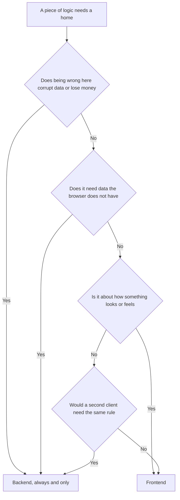
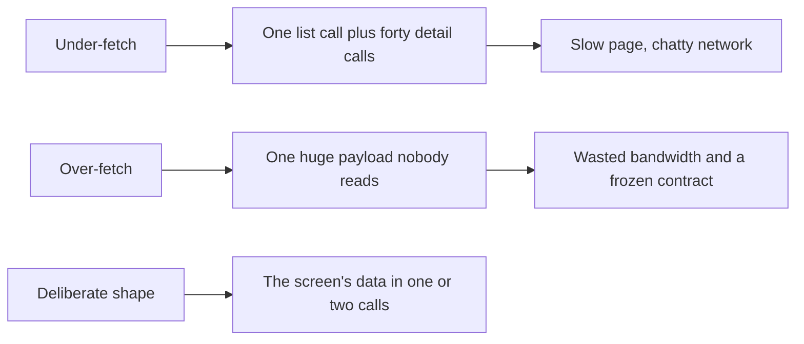

# What Belongs Where

You pick up a ticket: *"Invoices over £500 get a 5% early-payment discount if
paid within 7 days. Show it on the invoice page and apply it at checkout."*

Within a minute you are making decisions. Where is the 5% written down? Who
decides whether 7 days have passed? Does the browser calculate the new total, or
ask for it? If a user edits the number in devtools, what happens?

These questions have correct answers, and they come from one rule rather than
from taste. This file gives you that rule, applies it to the concerns in every
feature, and is honest about where both sides legitimately do the same work.

> **📌 In one line:** the backend owns truth and rules, the frontend owns
> presentation and interaction — and when both sides implement the same rule,
> only one of them is allowed to be believed.

## Table of Contents

1. [The Default Rule](#the-default-rule)
2. [The Decision Table](#the-decision-table)
3. [The Duplication That Is Correct](#the-duplication-that-is-correct)
4. [The Duplication That Is a Bug](#the-duplication-that-is-a-bug)
5. [BROKEN vs FIXED: the Total the Browser Computed](#broken-vs-fixed-the-total-the-browser-computed)
6. [Shaping the API for the Screens That Use It](#shaping-the-api-for-the-screens-that-use-it)
7. [Money and Dates Across the Wire](#money-and-dates-across-the-wire)
8. [Keeping Types in Sync](#keeping-types-in-sync)
9. [Who Owns the Loading Experience](#who-owns-the-loading-experience)
10. [A Checklist for a Full-Stack Ticket](#a-checklist-for-a-full-stack-ticket)
11. [Common Mistakes](#common-mistakes)
12. [Questions to Test Yourself](#questions-to-test-yourself)
13. [Related](#related)

---

## The Default Rule

Think about a cash machine. It has a screen, buttons, a language setting and a
receipt printer. It decides nothing. Whether you have the money, whether the
withdrawal is allowed, what your new balance is — all of that is decided inside
the bank, every time, even though the machine already shows a balance on its
screen. The machine's balance is a *picture* of the truth, taken a moment ago.
The bank's balance *is* the truth.

> **📌 Remember:** **the backend owns truth and rules. The frontend owns
> presentation and interaction.** Everything else in this file follows from
> that one sentence.

The reason is not a preference for server code. It is that the frontend runs on
a computer you do not control: the user can edit it, replay its requests, skip
it with `curl`, or run an old cached version from last Tuesday. Code there can
be *helpful*; it can never be *authoritative*.

Two useful questions when you are unsure:

1. **"If someone deleted the entire frontend and called this API with `curl`,
   would the system still behave correctly?"** If not, the logic is in the wrong
   place.
2. **"If two different clients existed — a web app and a mobile app — would this
   logic have to be written twice?"** If yes, it probably belongs on the server.



---

## The Decision Table

"Owns" means decides and is believed. "May duplicate" means the other side is
allowed to implement the same rule for a different purpose.

| Concern | Owner | May duplicate | Why |
|---|---|---|---|
| **Input validation** | Backend | Frontend, for instant feedback | The server is the only check that cannot be skipped |
| **Authorization** | Backend | Frontend, to hide what would be refused | A hidden button is not a locked door |
| **Business rules** (discounts, limits, state transitions) | Backend | **No** | Two copies drift, and the browser's copy is editable |
| **Derived totals** (subtotal, tax, invoice total) | Backend | Frontend, as a preview only | Money must be computed once, where it is stored |
| **Sorting and filtering** | Backend, for anything paginated | Frontend, within one loaded page | You cannot sort rows you have not fetched |
| **Pagination** | Backend | — | The client never sees the full set |
| **Search** | Backend | Frontend, for a small in-memory list | The index lives in the database |
| **Date and money formatting** | **Frontend** | — | Only the browser knows the user's locale and time zone |
| **Which fields exist in a response** | Backend | — | The DTO is the contract |
| **Permission-driven UI** (show or hide a button) | Frontend | Mirrors a backend rule | UX, backed by a server check |
| **Optimistic UI and retries** | Frontend | — | Interaction concerns |
| **Idempotency and transactions** | Backend | — | Correctness under concurrency |
| **Audit logging** | Backend | — | A client-written audit trail is worthless |
| **Feature flags** | Backend decides, frontend renders | — | A flag read only in the browser is not enforced |

Three rows deserve a second look. **Sorting** looks like a frontend concern and
is not: sorting the 25 rows currently on screen is presentation, but sorting
"all invoices by due date" when there are 4,000 of them is a database query —
see
[03-pagination-filtering-sorting.md](../../backend-fundamentals/02-rest-api-design/03-pagination-filtering-sorting.md).

**Formatting dates** is the one row where the frontend genuinely knows better.
The server does not know the user is in Dhaka and should not guess.

**Feature flags** split across the line: the server decides whether a feature is
on for this user and says so in the response, and the frontend only renders
accordingly. A flag evaluated only in the browser is a suggestion.

---

## The Duplication That Is Correct

It is tempting to treat all duplication as waste. It is not. Two rules are
*supposed* to exist on both sides, because they serve different purposes.

**Validation.** The frontend validates so the user finds out immediately, while
their attention is still on the field. The backend validates because it is the
only check that cannot be bypassed — the browser check is simply absent for a
`curl` request, an old cached bundle, or a mobile client. Same rule, two jobs.

```ts
// Frontend: fast feedback. Helpful, and skippable.
if (title.trim().length < 3) setError('Title must be at least 3 characters.')

// Backend: the real gate. Runs for every caller, always.
const data = await createProjectSchema.validate(request.body())
```

Remove the frontend check and the product feels clumsy. Remove the backend check
and you get a two-character project title in your database. See
[01-why-validation-matters.md](../../backend-fundamentals/04-validation-and-input/01-why-validation-matters.md).

**Permission awareness.** The frontend hides a Delete button the user may not
use, because offering an action that will fail is bad design. The backend
refuses the delete, because the button was never the control. See
[01-authn-vs-authz.md](../../backend-fundamentals/06-authorization/01-authn-vs-authz.md).

> **📌 Remember:** duplicating the **rule** is fine. Duplicating the
> **authority** is not. Exactly one side is allowed to be believed, and it is
> never the one running on the user's machine.

The practical way to keep two copies of a rule from drifting is to stop writing
them twice. Share one schema, import it on both sides, and the rule has one
definition with two call sites:

```ts
// packages/contracts/src/project.ts — imported by the API and the React app
export const createProjectSchema = z.object({
  name: z.string().min(3).max(120),
  companyId: z.string().uuid(),
  dueDate: z.string().datetime().optional(),
})
export type CreateProjectInput = z.infer<typeof createProjectSchema>
```

---

## The Duplication That Is a Bug

The dangerous version is a **business rule** that exists only in the frontend,
or in both places with the frontend's copy being trusted.

Signs you are looking at one:

- A number the server stores is calculated in a React component.
- A `const DISCOUNT_RATE = 0.05` in frontend code.
- A `POST` body with a field the server could compute itself — `total`, `tax`,
  `status`, `createdAt`.
- A condition like `if (invoice.amount > 50000) showApprovalWarning()` where the
  threshold appears nowhere on the server.

Each means the same thing: a rule a user can read, and often edit. Reading is a
problem on its own — your pricing tiers, approval thresholds and fraud limits
become public the moment someone opens the bundle, per
[05-talking-to-your-api-part-2.md](../01-react-fundamentals/05-talking-to-your-api-part-2.md)
on what a frontend bundle actually exposes.

Editing is worse, and it is the next section.

---

## BROKEN vs FIXED: the Total the Browser Computed

A real pattern, and a real way to lose money.

```tsx
// ❌ BROKEN — the browser computes the money and the server stores what it is told
function InvoiceCheckout({ items, paidWithinDays }: CheckoutProps) {
  const subtotal = items.reduce((sum, i) => sum + i.unitPrice * i.quantity, 0)
  const discount = subtotal > 50000 && paidWithinDays <= 7 ? subtotal * 0.05 : 0
  const total = Math.round(subtotal - discount)

  return <button onClick={() => pay({ invoiceId, total })}>Pay {format(total)}</button>
}
```

```ts
// ❌ BROKEN — the endpoint trusts a number that came from the user's computer
router.post('/v1/invoices/:id/pay', async ({ request, params }) => {
  const { total } = request.body() as { total: number }
  await chargeCard(params.id, total) // charges whatever the client said
})
```

The attack takes ten seconds: open devtools, change `total` to `1`, click Pay.
No bug was exploited. The browser was asked for a fact and answered.

Three faults are stacked here. The rule (`5%`, `£500`, `7 days`) lives only in
the browser, so changing it needs a frontend deploy and an old cached bundle
keeps the old price. The *decision* about what is owed is made on a machine you
do not control. And the server accepts a client-supplied amount.

```tsx
// ✅ FIXED — the client previews, the server decides
function InvoiceCheckout({ invoiceId }: { invoiceId: string }) {
  // The server returns the priced invoice: subtotal, discount, tax, total.
  const quote = useQuote(invoiceId)
  if (quote.isPending) return <QuoteSkeleton />

  return (
    <button onClick={() => pay({ invoiceId })}>
      Pay {formatMoney(quote.data.totalMinor, quote.data.currency)}
    </button>
  )
}
```

```ts
// ✅ FIXED — one pricing function, called by both the quote and the charge
router.post('/v1/invoices/:id/pay', async ({ params, auth }) => {
  const invoice = await Invoice.findOrFail(params.id)
  await bouncer.with('InvoicePolicy').authorize('pay', invoice)

  const priced = priceInvoice(invoice, { now: DateTime.now() }) // the only source
  await chargeCard(invoice, priced.totalMinor)
})
```

The frontend still shows a total — it must, the user has to see what they are
paying. The difference is that it **displays a number it was given** instead of
**producing a number that is believed**.

> **⚠️ Warning:** the test is not "does the client calculate anything". It is
> "if the client's number and the server's number disagree, which one wins". If
> the answer is ever the client's, you have this bug.

---

## Shaping the API for the Screens That Use It

The rule does not mean ignoring the frontend. An API nobody can build a screen
from is a bad API. Two failure modes, and they pull in opposite directions.

**Over-fetching** — the response carries far more than the screen needs. A task
list that returns each task's full description, every comment and the whole
assignee record, to render a title and an avatar. The cost is bandwidth on
mobile, slower queries, and a contract so wide you can never change it.

**Under-fetching** — the response is so minimal the client must make more calls
to be useful. `GET /tasks` returns `assigneeId`, so the page fires forty
requests for forty names. This is the **N+1 problem** you already know from the
database, moved onto the network where each round trip costs a hundred times
more. See
[n-plus-one-queries.md](../../databases/query-optimization/n-plus-one-queries.md).



The middle path is an **aggregate endpoint**: one response assembled for a known
screen, such as `GET /v1/projects/:id/overview` returning the project, its task
counts by status, and its five most recent activities. It has a cost, so choose
it deliberately:

| | Resource endpoints only | Aggregate endpoint |
|---|---|---|
| Round trips for one screen | Several | One |
| Reusable by other clients | High | Low, it is screen-shaped |
| Caching | Per resource, simple | Whole-blob, invalidated often |
| Changing the screen | No API change | API change, usually |

Add one when a screen is important, stable, and demonstrably slow with separate
calls. Do not add one per screen by reflex, or your API becomes a list of
view-models and your domain model disappears. The same tension is the argument
behind GraphQL and BFF layers —
[06-rest-vs-graphql-vs-rpc.md](../../backend-fundamentals/02-rest-api-design/06-rest-vs-graphql-vs-rpc.md).

> **💡 Tip:** the line is *which fields* versus *which entities*. Serving the
> fields a screen needs is good API design. Inventing a new entity because one
> screen is laid out that way is the UI dictating your domain model. DTOs are
> where you draw it —
> [04-dtos-and-serialization-part-1.md](../../backend-fundamentals/09-application-architecture/04-dtos-and-serialization-part-1.md).

---

## Money and Dates Across the Wire

Two value types cause more cross-stack bugs than everything else combined, and
both follow the same principle: **the server sends an unambiguous value, the
client renders it for a human.**

| | Server sends | Client renders |
|---|---|---|
| Money | `{ "amountMinor": 125000, "currency": "GBP" }` | `£1,250.00` |
| Timestamp | `"2026-10-04T14:30:00Z"` | `4 Oct 2026, 20:30` in Dhaka |
| Date only | `"2026-10-04"` | `04/10/2026` |
| Duration | `"durationSeconds": 5400` | `1h 30m` |

**Money in minor units.** Send `125000` pence, not `1250.00`. Floating point
cannot represent `0.1` exactly, so `0.1 + 0.2 !== 0.3` in every language in your
stack; integers of the smallest unit have no such problem. Always send the
currency too — a bare number is meaningless across companies.

**Timestamps in ISO 8601, in UTC, with the `Z`.** `"2026-10-04T14:30:00Z"` has
exactly one meaning everywhere. `"04/10/2026 14:30"` is ambiguous twice over —
is it April or October, and in whose time zone?

```ts
// ❌ BROKEN — the server guesses a format and a zone it cannot know
return { dueDate: invoice.dueAt.toFormat('dd/MM/yyyy HH:mm') }

// ✅ FIXED — the server sends a fact; the browser knows the user's locale
return { dueAt: invoice.dueAt.toUTC().toISO() } // "2026-10-04T14:30:00.000Z"

new Intl.DateTimeFormat(navigator.language, {
  dateStyle: 'medium', timeStyle: 'short',
}).format(new Date(invoice.dueAt))
```

A date with no time — a birthday, an invoice due date — is a different type and
should stay a plain `"2026-10-04"`. Turning it into a timestamp makes it shift
by a day for anyone west of UTC. The serialisation side of this is
[04-dtos-and-serialization-part-2.md](../../backend-fundamentals/09-application-architecture/04-dtos-and-serialization-part-2.md).

---

## Keeping Types in Sync

Your `Invoice` interface in React is a *claim* about what the API returns, and
nothing checks it. The server renames `due_date` to `dueAt`, TypeScript compiles
happily, and the page shows `Invalid Date` in production.

Three ways to stop hand-maintaining that claim:

| Approach | How it works | Good when |
|---|---|---|
| **Generate from the spec** | OpenAPI schema produces client types in CI | You already document the API |
| **Share a schema package** | One Zod or Valibot schema imported by both sides | One repo, one language |
| **Share types only** | A package exporting `type Invoice` | Minimum effort, no runtime check |

Generated or shared types turn a silent production bug into a build failure in
the pull request that caused it. The drift still happens; it is just caught by a
machine on the day it is introduced.

```ts
// One schema, two uses. The API validates with it; the client infers from it.
export const invoiceSchema = z.object({
  id: z.string().uuid(),
  amountMinor: z.number().int(),
  currency: z.string().length(3),
  status: z.enum(['draft', 'sent', 'paid', 'void']),
  dueAt: z.string().datetime(),
})
export type Invoice = z.infer<typeof invoiceSchema>
```

Note what this does *not* do: a shared schema is still only a shape. It does not
share the *rules*. Keep `priceInvoice` on the server even when the schema is
shared. The generic machinery behind `z.infer` is in
[generics.md](../../typescript-fundamentals/generics/generics.md), and schema
validation on the server is
[02-schema-validation.md](../../backend-fundamentals/04-validation-and-input/02-schema-validation.md).

> **⚠️ Warning:** a shared package creates coupling. If the API and the web app
> deploy independently, a type change becomes a deployment ordering problem.
> Version the contract and treat a field removal as a breaking change.

---

## Who Owns the Loading Experience

"The projects page is slow" arrives as a frontend ticket. It usually is not.

The frontend owns how waiting *feels*: skeletons that hold the layout, streaming
the shell before the data, not blocking a page on one slow widget — that is
[02-loading-error-and-empty-states.md](./02-loading-error-and-empty-states.md).

The backend owns how long the wait *is*, and no skeleton rescues a 4-second
endpoint. The usual causes are all server-side: an N+1 query loading each
project's owner one at a time, a missing index, no pagination, or a serialiser
touching relations nobody asked for.

```text
Symptom reported:  "the projects page takes four seconds"
Frontend fix:      a skeleton — it now takes four seconds and looks calmer
Backend fix:       one eager load and an index — it takes 120 ms
```

Both fixes are correct; only one makes the product fast. Measure first — if the
network tab shows one request taking 3.8 seconds, no amount of React will help.

> **💡 Tip:** a frontend ticket that is really a backend problem is the most
> common wasted week in full-stack work. Open devtools first and ask whether the
> time is in the request or after it.

---

## A Checklist for a Full-Stack Ticket

Before writing code, write down the answers. This extends the New Ticket
Checklist in [career-roadmap.md](../../doc/career-roadmap.md) across the wire.
Its backend questions are unchanged — requirement, tables, endpoints,
validation, failure behaviour, transactions, security, testing. Then add these,
for the boundary:

1. **What is the truth, and who computes it?** Name every number the screen
   shows and say which side produces it.
2. **What does the API return, field by field?** Write the JSON before either
   side's code. It is the contract both halves are built against.
3. **Which rules are duplicated, and why?** Confirm each duplicate is for
   feedback or visibility, never for authority.
4. **What are the five states of this screen?** Loading, empty, partial, error,
   success — including the empty state for a brand-new company.
5. **Which statuses can this endpoint return, and what does the UI do with
   each?** Especially 403, 409 and 422.
6. **Who can see this, and who can do it?** The hidden button and the server
   check are two separate pieces of work.
7. **How many requests does this screen make?** If a list leads to a request per
   row, fix the API, not the component.
8. **What happens on a slow or failed network?** Timeout, retry, and whether a
   retry can duplicate anything.

Answer these and the implementation is mostly typing. Skip them and you learn
the answers one bug report at a time.

---

## Common Mistakes

| Mistake | Why it is wrong | Do this instead |
|---|---|---|
| Computing a stored total in the browser | The user can edit the number before it is sent | Server computes and returns it; the client displays it |
| A `POST` body containing `total`, `status` or `createdAt` | Accepting a value the server could derive invites tampering | Accept inputs only; derive the rest |
| A business threshold as a frontend constant | Readable by anyone and drifts from the server copy | One definition on the server, exposed only if needed |
| Validating only on the client | `curl` skips it entirely | Validate on both; believe only the server |
| Validating only on the server | Every typo costs a round trip | Share one schema, run it in both places |
| Server formatting dates or money | It cannot know the user's locale or time zone | Send ISO 8601 UTC and minor units; format in the browser |
| Floats for money | `0.1 + 0.2 !== 0.3` in every language involved | Integer minor units plus a currency code |
| Hand-written client types for API responses | A renamed field fails silently in production | Generate or share the types |
| An aggregate endpoint per screen | Your domain model becomes a pile of view-models | Add one only for an important, stable, measurably slow screen |
| Fixing a slow page with a nicer skeleton | It stays slow and now hides it | Measure; usually the fix is a query or an index |

## Questions to Test Yourself

1. State the default rule in one sentence, and give the two questions that let
   you apply it to anything.
2. Validation lives on both sides. What different job does each copy do, and
   which one is allowed to be wrong without consequence?
3. "Duplicating the rule is fine, duplicating the authority is not." Give an
   example of each from the discount ticket at the top of this file.
4. Your checkout sends `{ invoiceId, total }`. Describe the exploit and the
   smallest change that closes it.
5. Why is sorting a paginated list a backend concern, while sorting the rows
   currently on screen is not?
6. Why does the server send `125000` and `"2026-10-04T14:30:00Z"` rather than
   `"£1,250.00"` and `"04/10/2026"`?
7. What problem does an aggregate endpoint solve, and what does it cost? When is
   adding one wrong?
8. A page takes four seconds and the network tab shows one request taking 3.8 of
   them. Which side owns the fix, and what are the two likeliest causes?

## Related

- [01-why-validation-matters.md](../../backend-fundamentals/04-validation-and-input/01-why-validation-matters.md)
  and [02-schema-validation.md](../../backend-fundamentals/04-validation-and-input/02-schema-validation.md)
  — the server half of the correct duplication.
- [01-authn-vs-authz.md](../../backend-fundamentals/06-authorization/01-authn-vs-authz.md)
  — why a hidden button is not a permission.
- [06-rest-vs-graphql-vs-rpc.md](../../backend-fundamentals/02-rest-api-design/06-rest-vs-graphql-vs-rpc.md)
  — the over-fetching and under-fetching argument at protocol scale.
- [04-dtos-and-serialization-part-1.md](../../backend-fundamentals/09-application-architecture/04-dtos-and-serialization-part-1.md)
  and [part 2](../../backend-fundamentals/09-application-architecture/04-dtos-and-serialization-part-2.md)
  — shaping responses, and serialising money and dates.
- [n-plus-one-queries.md](../../databases/query-optimization/n-plus-one-queries.md)
  — the pattern that turns a fast page into a slow one.
- [generics.md](../../typescript-fundamentals/generics/generics.md) — how
  `z.infer` derives a type from a schema.
- [career-roadmap.md](../../doc/career-roadmap.md) — the New Ticket Checklist
  this file extends across the stack.
